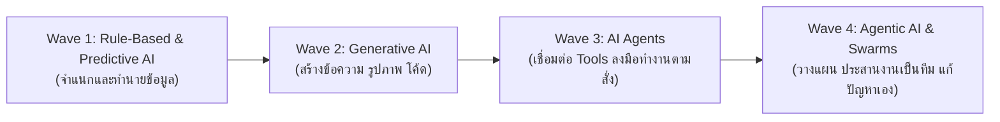
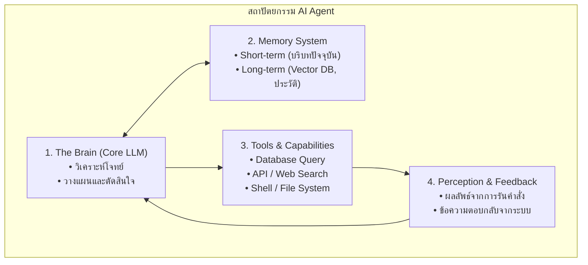
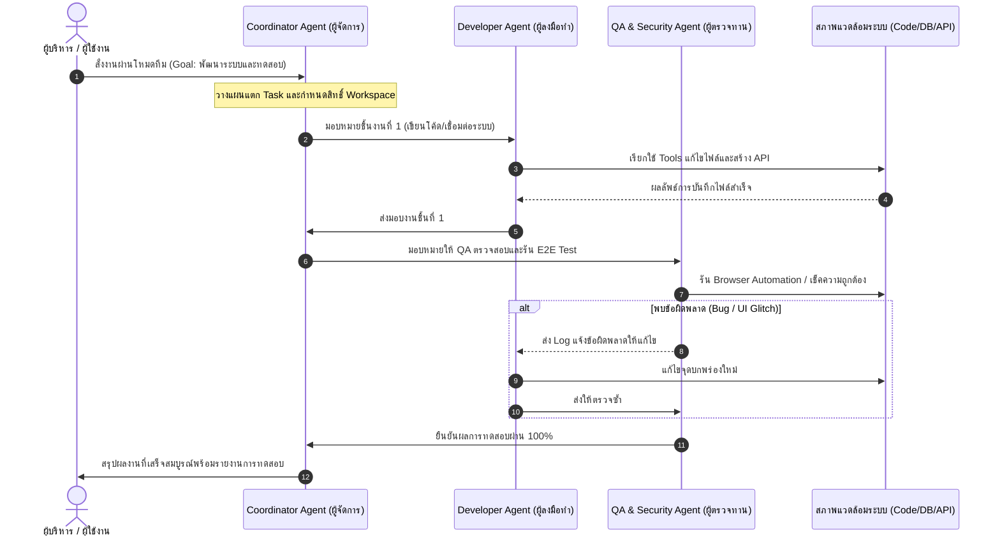

# 📘 เอกสารเชิงกลยุทธ์และวิศวกรรมสำหรับผู้บริหาร (Executive Whitepaper)
**หัวข้อ:** นิยาม สถาปัตยกรรม และวิวัฒนาการของระบบปัญญาประดิษฐ์: จาก AI ธรรมดา สู่ AI Agent และ Agentic AI (Multi-Agent Systems)  
**จัดทำเพื่อ:** นำเสนอหัวหน้าฝ่ายและประธานกรรมการบริหาร (Board of Directors / Executive Presentation)  
**วันที่:** 19 พฤศจิกายน 2026  

---

## Executive Summary (บทสรุปย่อสำหรับประธานบริหาร)

ในปัจจุบัน เทคโนโลยี AI กำลังเปลี่ยนผ่านจาก **"Generative AI ยุคแรก (ยุคถาม-ตอบ)"** ไปสู่ **"Agentic AI (ยุคสั่งการให้ลงมือปฏิบัติการ)"**:
1. **AI ธรรมดา (Traditional / Generative AI):** เปรียบเสมือน **"ที่ปรึกษาในห้องประชุม"** มีความรู้สูงมาก ตอบคำถามได้รอบด้าน แต่มนุษย์ต้องเป็นคนจดคำตอบ แล้วเดินไปกดระบบ ลงมือทำงานต่อเอง
2. **AI Agent:** เปรียบเสมือน **"พนักงานดิจิทัล (Digital Worker)"** ที่ไม่ได้มีแค่สมอง แต่มี "มือและเท้า" (Tools & APIs) สามารถรับโจทย์ ไปเปิดระบบ ดึงข้อมูล วิเคราะห์ และคลิกทำงานจนจบกระบวนการได้
3. **Agentic AI:** คือ **"ระบบการบริหารจัดการทีมงานอัตโนมัติ (Autonomous System Paradigm)"** ที่ Agent แต่ละตัวสามารถวางแผน (Planning), แบ่งงาน (Delegation), ตรวจสอบความถูกต้องของตัวเอง (Self-Correction/Reflection) และทำงานร่วมกันเป็นทีม (Multi-Agent Swarm) เพื่อส่งมอบผลลัพธ์ระดับองค์กร

---

## สารบัญโครงสร้างเอกสาร
1. [ภาพรวมวิวัฒนาการ 4 ยุคของ AI (The 4 Waves of AI)](#1-ภาพรวมวิวัฒนาการ-4-ยุคของ-ai-the-4-waves-of-ai)
2. [ตารางเปรียบเทียบเชิงลึก: AI ธรรมดา vs AI Agent vs Agentic AI](#2-ตารางเปรียบเทียบเชิงลึก-ai-ธรรมดา-vs-ai-agent-vs-agentic-ai)
3. [กายวิภาคและสถาปัตยกรรมภายในของ AI Agent (Anatomy of an AI Agent)](#3-กายวิภาคและสถาปัตยกรรมภายในของ-ai-agent-anatomy-of-an-ai-agent)
4. [Agentic AI และรูปแบบการออกแบบระบบ (Agentic Design Patterns)](#4-agentic-ai-และรูปแบบการออกแบบระบบ-agentic-design-patterns)
5. [เทคโนโลยีแวดล้อมที่เกี่ยวข้อง (Ecosystem & Key Terminology)](#5-เทคโนโลยีแวดล้อมที่เกี่ยวข้อง-ecosystem--key-terminology)
6. [กรณีศึกษาจริง: จากคำสั่งเดี่ยว สู่ระบบ Team-Preview / Multi-Agent ในองค์กร](#6-กรณีศึกษาจริง-จากคำสั่งเดี่ยว-สู่ระบบ-team-preview--multi-agent-ในองค์กร)
7. [ผลตอบแทนทางธุรกิจ (Business Value & ROI) และความท้าทายด้านความปลอดภัย](#7-ผลตอบแทนทางธุรกิจ-business-value--roi-และความท้าทายด้านความปลอดภัย)
8. [แนวทางการนำเสนอประธาน (Key Talking Points for Executive Pitch)](#8-แนวทางการนำเสนอประธาน-key-talking-points-for-executive-pitch)

---

## 1. ภาพรวมวิวัฒนาการ 4 ยุคของ AI (The 4 Waves of AI)

* **Wave 1 (Predictive AI):** เช่น ระบบตรวจจับของเสียด้วย Computer Vision, ระบบพยากรณ์ยอดขาย (Machine Learning แบบดั้งเดิม) ทำงานเฉพาะทางตามโมเดลคณิตศาสตร์
* **Wave 2 (Generative AI - LLMs):** เช่น ChatGPT, Gemini แชตบอตที่เข้าใจภาษามนุษย์ สรุปเอกสาร และเขียนเนื้อหาได้ แต่เป็นระบบ Passive รอรับ Prompt ทีละครั้ง
* **Wave 3 (AI Agents):** AI เริ่มมีตัวตน (Autonomous Entity) สามารถเข้าถึงเครื่องมือ (Tool Use) เช่น เปิดดู Database, เรียก API ภายนอก, รันโปรแกรมเพื่อทำงานอัตโนมัติ
* **Wave 4 (Agentic AI Systems):** ระบบคิด ตัดสินใจ และทำงานต่อเนื่องเป็นขบวนการ (Multi-step Loops) มีการตรวจทานความผิดพลาด (Reflection) และทำงานร่วมกันหลายโมเดล (Multi-Agent Systems)

---

## 2. ตารางเปรียบเทียบเชิงลึก: AI ธรรมดา vs AI Agent vs Agentic AI

| มิติการเปรียบเทียบ | 1. Traditional / Generative AI ("AI ธรรมดา") | 2. AI Agent | 3. Agentic AI (Multi-Agent System) |
| :--- | :--- | :--- | :--- |
| **ความหมายพื้นฐาน** | โมเดลปัญญาประดิษฐ์ที่แปลง Input เป็น Output | โปรแกรมซอฟต์แวร์ที่ใช้โมเดลเป็นสมอง + มีเครื่องมือเชื่อมต่อโลกภายนอก | ปรัชญาและสถาปัตยกรรมระบบที่ให้ AI มีอิสระในการวางแผน ลงมือทำ และตรวจแก้งานจนสำเร็จเป้าหมาย |
| **ลูปการทำงาน (Execution Loop)** | **One-Shot:** Prompt $\rightarrow$ Response (จบในรอบเดียว) | **Linear Task Loop:** Goal $\rightarrow$ Call Tool A $\rightarrow$ Call Tool B $\rightarrow$ Deliver Result | **Autonomous Iterative Loop:** Goal $\rightarrow$ Plan $\rightarrow$ Execute $\rightarrow$ Evaluate/Test $\rightarrow$ Re-plan/Self-correct |
| **การเข้าถึงระบบจริง (Environment & Tools)** | ❌ ไม่มี (ทำได้แค่ออกข้อความในหน้าจอ) | ✅ มี (เชื่อมต่อ API, ฐานข้อมูล, สคริปต์เฉพาะ) | ✅ ครบวงจร (เชื่อมต่อระบบทั้งองค์กร, Browser, Git, DB, และจำลองสภาพแวดล้อมได้) |
| **การจัดการเมื่อเกิดข้อผิดพลาด (Error Handling)** | ทำไม่ได้ (ถ้าตอบผิด มนุษย์ต้องเป็นคนบอกว่าผิด) | แจ้ง Error กลับมาให้ผู้ใช้ทราบ | **Self-Healing:** วิเคราะห์ Log ข้อผิดพลาด แล้วลองหาวิธีการใหม่เองจนกว่าจะสำเร็จ |
| **การทำงานร่วมกัน (Collaboration)** | ไม่มี (ทำงานเดี่ยว) | ทำงานเดี่ยวตามภารกิจที่ได้รับ | **Multi-Agent Coordination:** มี Coordinator, Workers, QA Reviewer ประสานงานกัน |
| **ระดับการมีส่วนร่วมของมนุษย์ (Human Effort)** | สูงมาก (ต้องป้อนคำสั่งทีละสเต็ป และนำผลลัพธ์ไปลงมือทำเอง) | ปานกลาง (สั่งเป้าหมาย รอรับผลงาน) | ต่ำถึงระดับกำกับดูแล (Human-in-the-loop: อนุมัติเฉพาะจุดวิกฤต เช่น การจ่ายเงิน หรือ Deploy ระบบ) |

---

## 3. กายวิภาคและสถาปัตยกรรมภายในของ AI Agent (Anatomy of an AI Agent)

การที่ AI ตัวหนึ่งจะยกระดับเป็น "AI Agent" ได้ จะต้องมีองค์ประกอบหลัก 4 ส่วน (The 4 Pillars):

1. **The Brain (สมองประมวลผล):** ใช้ Large Language Model ชั้นสูง (เช่น Gemini, Claude, GPT) ทำหน้าที่แปลงภาษามนุษย์เป็นตรรกะและแผนงาน
2. **Memory System (ระบบความจำ):**
   * *Short-term Memory:* บริบทของงานปัจจุบัน (Working Context Window)
   * *Long-term Memory:* การดึงฐานความรู้เดิมผ่าน RAG (Retrieval-Augmented Generation) หรือฐานข้อมูล Vector ทำให้จำกฎเกณฑ์องค์กรได้ไม่ลืม
3. **Tools & Actuators (เครื่องมือและแขนขา):** ฟังก์ชันหรือ API ที่ Agent ได้รับอนุญาตให้เรียกใช้ เช่น สั่งค้นหาข้อมูลใน ERP/MES, สั่งเปิดหน้าเว็บ, สั่งรัน Unit Test
4. **Planning & Feedback Loop (กลไกการรับรู้และวางแผน):** การอ่านผลลัพธ์ที่เครื่องมือส่งกลับมา เพื่อดูว่าการกระทำสำเร็จหรือไม่ ก่อนจะตัดสินใจในก้าวถัดไป

---

## 4. Agentic AI และรูปแบบการออกแบบระบบ (Agentic Design Patterns)

คำว่า **Agentic AI** ได้รับการยอมรับในระดับสากลว่าประกอบด้วย 4 รูปแบบการออกแบบหลัก (Four Core Patterns):

### 1. Reflection (การไตร่ตรองและวิจารณ์ตัวเอง)
แทนที่จะปล่อยให้คำตอบแรกถูกส่งออกไป ระบบจะสร้างลูปให้ Agent ตรวจสอบผลงานตัวเอง:
* *ตัวอย่าง:* Agent เขียนโค้ดระบบเสร็จ $\rightarrow$ Agent สลับบทบาทเป็น QA ตรวจสอบโค้ด $\rightarrow$ พบช่องโหว่ความปลอดภัย $\rightarrow$ แก้ไขโค้ดใหม่จนสมบูรณ์ก่อนส่งมอบ

### 2. Tool Use (การใช้เครื่องมือภายนอก)
Agent รู้ว่าเมื่อใดที่ความรู้ในสมองตัวเองไม่เพียงพอ และตัดสินใจดึงข้อมูลแบบ Real-time:
* *ตัวอย่าง:* เมื่อถามยอดสต็อกสินค้า Agent จะไม่เดา แต่จะยิงคำสั่ง SQL ไปดึงยอดจริงจากฐานข้อมูลคลังสินค้า

### 3. Planning (การวางแผนและแตกงานย่อย)
การรับเป้าหมายระยะยาว (Long-horizon Goal) แล้วแตกออกเป็น Roadmap:
* *ตัวอย่าง:* เป้าหมาย "ทำระบบรายงาน OEE ประจำวัน" $\rightarrow$ สเต็ป 1: ดึงรอบเวลาเครื่องจักร $\rightarrow$ สเต็ป 2: คำนวณ Downtime $\rightarrow$ สเต็ป 3: สร้างกราฟ $\rightarrow$ สเต็ป 4: ส่งอีเมลรายงาน

### 4. Multi-Agent Collaboration (การทำงานร่วมกันเป็นทีม)
การกระจายความเชี่ยวชาญ (Separation of Concerns) ไปยังหลาย Agent:
* มี **Manager / Coordinator Agent:** ควบคุมภาพรวมและแบ่งงาน
* มี **Specialist Agents:** ทำงานเฉพาะด้าน เช่น Data Analyst, Developer, Security Auditor
* คุยกันผ่าน Message Board หรือ API ทำให้งานขนาดใหญ่สำเร็จได้เร็วและผิดพลาดต่ำกว่าใช้ AI ตัวเดียว

---

## 5. เทคโนโลยีแวดล้อมที่เกี่ยวข้อง (Ecosystem & Key Terminology)

เพื่อให้ผู้บริหารเข้าใจภาพรวมของ Ecosystem อุตสาหกรรม AI ในปัจจุบัน ควรเข้าใจคำศัพท์หลักเหล่านี้:

* **MCP (Model Context Protocol):** มาตรฐานสากลใหม่ (สร้างโดย Anthropic และกำลังเป็นมาตรฐานเปิด) ที่ทำให้อุปกรณ์และโปรแกรมต่างๆ สามารถเชื่อมต่อเข้ากับ AI Agent ได้อย่างปลอดภัย เปรียบเหมือนพอร์ต "USB-C สำหรับ AI"
* **RAG (Retrieval-Augmented Generation):** การเชื่อม AI เข้ากับคลังเอกสารภายในองค์กร เพื่อให้ AI ตอบคำถามได้ถูกต้องตามระเบียบและนโยบายภายในโดยไม่ต้องนำข้อมูลไปเทรนใหม่
* **Function Calling / Tool Calling:** ความสามารถของโมเดลในการส่งคำสั่ง JSON ออกมาเพื่อบอกโปรแกรมภายนอกว่า "ฉันต้องการให้คุณรันฟังก์ชันนี้ ด้วยพารามิเตอร์นี้"
* **Human-in-the-Loop (HITL):** สถาปัตยกรรมความปลอดภัยที่กำหนดให้ AI ทำงานอัตโนมัติได้ทุกขั้นตอน **ยกเว้น** จุดที่มีความเสี่ยงสูง (เช่น การกดโอนเงิน, การลบข้อมูลสำคัญ, การสั่งเดินเครื่องจักรจริง) จะต้องหยุดเพื่อรอการอนุมัติจากมนุษย์ก่อนเสมอ
* **Swarm / Multi-Agent Frameworks:** เฟรมเวิร์กจัดการ Agent หลายตัว (เช่น LangGraph, AutoGen, CrewAI, Swarm)

---

## 6. กรณีศึกษาจริง: จากคำสั่งเดี่ยว สู่ระบบ Team-Preview / Multi-Agent ในองค์กร

เมื่อผู้ใช้พิมพ์คำสั่งในโหมด **`team-preview`** หรือระบบทีม Agent ระบบเบื้องหลังจะทำงานในรูปแบบ Agentic AI เต็มรูปแบบ ดังแผนภาพ:

---

## 7. ผลตอบแทนทางธุรกิจ (Business Value & ROI) และความท้าทายด้านความปลอดภัย

### 💰 ผลตอบแทนทางธุรกิจ (Business Impact & ROI)
1. **ลดต้นทุนกระบวนการทำงานที่ซ้ำซ้อน (Repetitive Process Automation):** งานที่ต้องเปิดหลายโปรแกรม (เช่น เปิด SAP $\rightarrow$ โหลด Excel $\rightarrow$ สรุปเข้า MES $\rightarrow$ ส่งไลน์) Agent สามารถทำจบในเสี้ยววินาที
2. **การทำงานแบบ 24/7 ไร้รอยต่อ (Continuous Operations):** สามารถตั้ง Scheduled Autonomous Agents ให้ทำการตรวจสอบความถูกต้องของข้อมูล (Audit), จัดเตรียมรายงานก่อนประชุมเช้า, หรือมอนิเตอร์ไลน์ผลิตกะกลางคืนได้
3. **ลด Human Error ในงาน Data Verification:** การให้ Agent ตรวจสอบความถูกต้องของบิล สต็อก หรือคุณภาพสินค้า ช่วยตัดปัญหาข้อมูลตกหล่น

### 🛡️ ความท้าทายและการควบคุมความเสี่ยง (Governance & Risk Management)
* **Risk 1: AI หลอนข้อมูล (Hallucination):** 
  * *การแก้ไข:* สถาปัตยกรรม Agentic AI แก้ปัญหานี้โดยบังคับให้ใช้ Tool ดึงข้อเท็จจริง (Grounding Data) และมี Agent อีกตัวตรวจทาน (Cross-Check) เสมอ
* **Risk 2: ความปลอดภัยและการเข้าถึงข้อมูล (Access Control & Permissions):**
  * *การแก้ไข:* บังคับใช้ Least Privilege Principle ให้ Agent มีสิทธิ์เท่าที่จำเป็น และมีระบบ Human-in-the-loop ในขั้นตอนที่กระทบฐานข้อมูลหลัก

---

## 8. แนวทางการนำเสนอประธาน (Key Talking Points for Executive Pitch)

หากมีเวลาในการนำเสนอต่อหน้าประธาน 3-5 นาที แนะนำให้สื่อสาร 3 ประเด็นสำคัญดังนี้:

> 1. **"ท่านประธานครับ AI ยุคนี้ไม่ได้มีแค่แชตบอตตอบคำถามอีกต่อไปแล้ว แต่เรากำลังเข้าสู่ยุค AI Agent ซึ่งเปรียบเหมือนการมี 'พนักงานดิจิทัล' ที่มีมือมีเท้าและสามารถลงมือทำงานจริงในระบบได้"**
> 
> 2. **"คำสั่งอย่าง team-preview ที่เราใช้งาน คือตัวอย่างของ Agentic AI ที่สร้างทีมงาน AI ขึ้นมาแบ่งหน้าที่กัน ตัวหนึ่งวิเคราะห์ ตัวหนึ่งลงมือทำ และอีกตัวหนึ่งคอยตรวจจับข้อผิดพลาด ทำให้งานเสร็จเร็วขึ้นหลายเท่าและมีคุณภาพสูง"**
> 
> 3. **"ทิศทางขององค์กรเรา การผสาน Agentic AI เข้ากับระบบโรงงาน (MES/ERP) จะช่วยให้เราเปลี่ยนผ่านจากการทำงานแบบตั้งรับ ไปสู่ระบบโรงงานอัจฉริยะที่ตรวจสอบตัวเอง แจ้งเตือนล่วงหน้า และทำงานประสานกันได้อัตโนมัติตลอด 24 ชั่วโมงครับ"**

