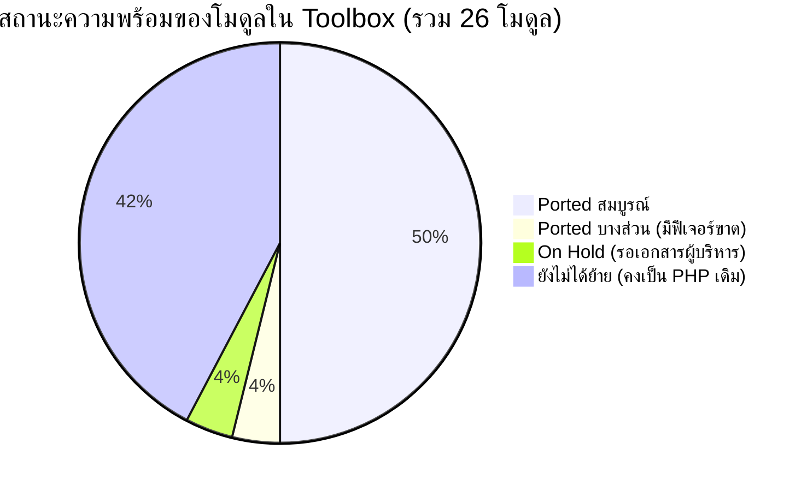
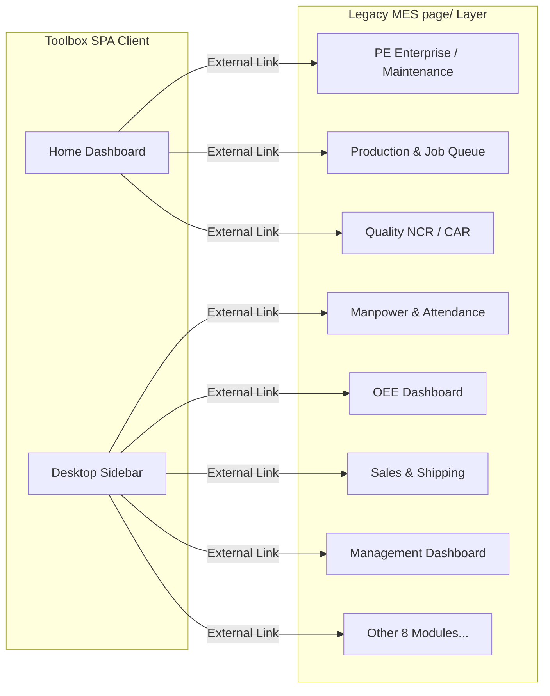

# 📋 รายงานผลการตรวจสอบข้อบกพร่องและฟีเจอร์ที่ขาดหาย (MES Legacy vs Toolbox Audit)
**ระบบเดิม (`page/`) VS ระบบใหม่ (`Toolbox/`)**  
*วันที่ตรวจสอบล่าสุด: 14 พฤศจิกายน 2026 (อัปเดต Phase 2.3: Ported iQMS Quality Management — NCR, CAR 8D Internal, Concession, Claim Verification, QA/QC Planner & Schedule ครบสมบูรณ์; ข้าม External Customer Token Approval ตามขอบเขต) | บทบาท: MES Quality Assurance & Senior Systems Auditor*

---

## Executive Summary (ภาพรวมสถานะการย้ายระบบ)

จากการตรวจสอบโครงสร้างโค้ด หน้าจอ UI ระบบฐานข้อมูล และ API ทั้งหมดระหว่างระบบเดิม (`MES/page/` จำนวน 26 โมดูล) และระบบใหม่ (`MES/Toolbox/` สถาปัตยกรรม React SPA) สรุปภาพรวมสถานะได้ดังนี้ *(หมายเหตุ: ยังมีโมดูลที่ย้ายมาจากแอปแยกอย่าง `Learning Hub` และ `Team Planner` รวมถึงโมดูลใหม่ `System Blueprint` ที่ใช้งานได้สมบูรณ์ 100% ใน Toolbox แล้ว)*:

| สถานะโมดูล | จำนวน | รายละเอียด |
| :--- | :---: | :--- |
| **✅ Ported 100% (สมบูรณ์)** | **15** | `Admin (User Management)`, `System Settings`, `Profile`, `PaintChem`, `Utility (รวม IoT Ingestion)`, `Document Center (รวม 3D CAD WebGL Viewer)`, **`Store Management (ครบ 8 แท็บ + Audit Certificate + IndexedDB Offline)`**, **`Daily Log & Mood Insights (สมุดบันทึกกะ + รายงานสุขภาพใจ)`**, **`Transport & Freight FleetLog (รถรับส่ง + บัญชีเที่ยวรถ)`**, **`Forklift Command & Tracking (Live Map + Heatmap + ESP32 IoT + QR Scan)`**, **`Production Execution & Scan Barcode (บันทึกผลิต + คิวงาน KDS + พิมพ์แท็ก 4"×2" + สแกนบาร์โค้ด)`**, **`PE Enterprise & Maintenance (Work Orders, Machines, Spare Parts MRO, Stop Request, PE Tech Mobile, Downtime MTBF/MTTR, Safety/LOTO/Pre-Op, IIoT & 2D Visual Board)`**, **`iQMS Quality Management (#/qms: NCR, CAR 8D, Concession 4-Stage Approval, Claim Verification & QA/QC Schedule/Planner — ยกเว้น External Customer Token Approval ที่รอผลจากทีม QA)`**, **`Manpower Management (#/manpower: จัดคนลงไลน์ 7 แท็บ, ประเมินเกรด 4D, Trend, Skill Matrix, วันหยุด & Master)`**, **`Daily Command Center / Planning (#/planning: แผนผลิต Plan vs Actual, Morning Brief, Loading 7 วัน & Stock Shortage)`** |
| **⚠️ Partially Ported (ย้ายบางส่วน / มีฟีเจอร์ขาดหาย)** | **1** | `AreaAccess / ScanBarcode` *(ส่วน `ScanBarcode` ย้ายเข้า `#/scan-barcode` แล้ว 100% เหลือเฉพาะ `AreaAccess`)* |
| **⏳ On Hold (รอเอกสารผู้บริหาร)** | **1** | `Inbound Hub` (พักไว้ชั่วคราว อยู่ระหว่างรอเอกสารตัวอย่างจริงจากผู้บริหาร) |
| **❌ Unported (ยังไม่ได้พอร์ต / ลิงก์ไปยัง PHP เดิม)** | **9** | `AccessoriesInspection`, `Management`, `OEE_Dashboard`, `Sales`, `LoadingReport`, `DailyPL`, `AutoInvoice`, `CCTV_Downloader`, `AreaAccess` *(หมายเหตุ: หน้าจอ Control Room ทั้ง 5 จอ รองรับ Zero-Touch Auto-Boot 24/7 บนระบบเดิมแล้วเมื่อ 09/11/2026)* |

---

## 1. การตรวจสอบโมดูลที่ย้ายแล้ว (Ported Modules) — ข้อบกพร่องและฟีเจอร์ที่ขาดหาย

### 1.1 Store Management (ระบบบริหารคลังสินค้า)
* **Legacy:** `page/storeManagement/` (15 PHP, 14 JS)
* **Toolbox:** `Toolbox/src/modules/Store/` (15 ไฟล์) + `Toolbox/public/api/store/storeApi.php`
* **สถานะ:** ✅ **ย้ายแล้ว 100% (สมบูรณ์ — ครบทั้ง 8 แท็บปฏิบัติการใน SPA + ใบรับรองผลตรวจนับ ISO/IATF เมื่อ 10/11/2026)**

| ฟีเจอร์ย่อย | Legacy (`page/`) | Toolbox (`Toolbox/`) | สถานะ & ข้อบกพร่องที่พบ |
| :--- | :--- | :--- | :--- |
| **Onhand Stock Dashboard** | `inventoryDashboard.php` | `InventoryDashboardTab.jsx` | ✅ **ย้ายสมบูรณ์**: ตารางยอดคงเหลือแบบเรียลไทม์ ตัวกรองหมวดหมู่ ค้นหา และปุ่ม Export to Excel (.xlsx) |
| **Visual Cycle Count Map** | `cycleCount.php` | `CycleCountTab.jsx` | ✅ **ย้ายสมบูรณ์**: แผนผังจำลองคลังสินค้าตามพิกัดจริง รองรับ Blind Count, Zone Settings, Zone Health และ Quick Scanner |
| **Pending Approvals** | `inventoryDashboard.php` | `PendingApprovalsTab.jsx` | ✅ **ย้ายสมบูรณ์**: เวิร์กโฟลว์หัวหน้างานอนุมัติ/ปฏิเสธยอดผลต่างการตรวจนับ (Variance Resolution) |
| **Stock Ledger (บัญชีสต็อก)** | `stockTransaction.php` | `StockLedgerTab.jsx` | ✅ **ย้ายสมบูรณ์**: รายการบัญชีความเคลื่อนไหวสต็อกย้อนหลัง พร้อมตัวกรองวันที่ ประเภทธุรกรรม และค้นหา |
| **Material Requisition (เบิกพัสดุ)** | `materialReq.php` | `MaterialRequisitionTab.jsx` | ✅ **ย้ายสมบูรณ์**: แคตตาล็อกรายการพัสดุพร้อมตัวกรองหมวดหมู่, ตะกร้าสินค้าสไตล์ E-Commerce Cart, สลับประเภทคำขอ (Stock vs K2 PR), ผูกคลังปลายทาง WIP และ MES Internal Job สำหรับหน้าไลน์, และหน้าประวัติคำขอเบิกพัสดุย้อนหลัง |
| **Store KDS Queue & PRD Return** | `storeDashboard.php` | `StoreKdsQueueTab.jsx` | ✅ **ย้ายสมบูรณ์ (10/11/2026)**: คิวจ่ายพัสดุสโตร์ Split-Pane, เลือกแท็ก FIFO/Manual, คิวเปิดเลขที่ K2 PR และระบบสแกนรับคืนวัตถุดิบจากฝ่ายผลิต (`PRD Return`) |
| **RM Receiving & Tagging (รับวัตถุดิบ & แท็ก)** | `rmReceiving.php` | `RmReceivingTab.jsx` | ✅ **ย้ายสมบูรณ์**: แดชบอร์ด KPI (Total Tags, Total Qty, Printed, Pending), ตารางและบัตรแท็ก, การยืนยันรับเข้าสต็อกแบบกลุ่ม (Bulk Receive to Location), การออกป้ายแท็กพร้อมพิมพ์ QR Code และ Export Excel |
| **Trace Tag History (สืบย้อนแท็ก)** | `tagHistory.php` | `RmReceivingTab.jsx` (`isTraceModalOpen`) | ✅ **ย้ายสมบูรณ์**: ระบบสืบค้นเส้นทางประวัติแท็ก (Tag Genealogy Timeline) แสดงข้อมูลสินค้า จำนวนคงเหลือ จุดจัดเก็บ PO, ไทม์ไลน์ธุรกรรมย้อนหลัง และแนะนำรหัสแท็กเมื่อสแกน/พิมพ์ไม่ครบ (`Prefix Match Suggestion`) |
| **Scrap & Replacement (เบิกของเสีย/ทดแทน)** | `storeRequest.php` | `ScrapReplacementTab.jsx` | ✅ **ย้ายสมบูรณ์ (10/11/2026)**: แดชบอร์ด KPI, แจ้งของเสียและเบิกทดแทน, อนุมัติด้วยมือแบบเดี่ยว/กลุ่ม (Strict Manual Approve/Reject), Export Excel และ Scrap Analytics Dashboard |
| **ISO/IATF Audit Certificate** | `print_cycle_count_audit.php` | `CycleCountAuditModal.jsx` | ✅ **ย้ายสมบูรณ์ (10/11/2026)**: ทะเบียนประวัติตรวจนับย้อนหลัง, Export Excel และใบรับรองทางการ `FM-WH-CC-01 REV.02` ขนาด A4 แนวนอนพร้อม IRA % และช่องลงนาม 3 ระดับ |
| **Offline-First Resilience Queue** | `storeOffline.js` | `storeOfflineEngine.js`, `StoreOfflineBanner.jsx` | ✅ **ย้ายสมบูรณ์ (14/11/2026)**: IndexedDB FIFO Queue (`MES_Store_Offline_v1`) พร้อม Banner แสดงสถานะ/ดูคิว/ซิงค์อัตโนมัติ-แมนนวล สำหรับ Cycle Count, RM Receiving, Material Requisition และ Scrap Replacement |

---

### 1.2 Document Center (ศูนย์รวมเอกสารและคู่มือปฏิบัติงาน)
* **Legacy:** `page/documentCenter/` (11 PHP, 1 JS)
* **Toolbox:** `Toolbox/src/modules/DocumentCenter/` (11 ไฟล์)
* **สถานะ:** ✅ **ย้ายแล้ว 100% (สมบูรณ์)**

| ฟีเจอร์ย่อย | Legacy (`page/`) | Toolbox (`Toolbox/`) | สถานะ & ข้อบกพร่องที่พบ |
| :--- | :--- | :--- | :--- |
| **Folder & File Explorer** | `documentCenterUI.php` | `DocumentCenterPage.jsx` | ✅ ย้ายสมบูรณ์ รองรับ Breadcrumb, Tree view, ค้นหา, กรองหมวด |
| **Document Actions** | Modals ต่างๆ | Modals ใน React | ✅ ย้ายสมบูรณ์ (Upload, Rename, Revise version, Move folder, Delete) |
| **PDF & Image Preview** | `viewDocModal.php` | `DocumentPreviewModal.jsx` | ✅ ย้ายสมบูรณ์ แสดงผล PDF และรูปภาพในตัว |
| **Interactive 3D CAD Viewer** | `view3DModal.php` | `DocumentPreviewModal.jsx` (`ThreeDViewer.jsx`) | ✅ **ย้ายสมบูรณ์**: พอร์ต Online 3D Viewer (Three.js WebGL) รองรับการหมุน (Rotate), เลื่อน (Pan), ซูม (Zoom), คำนวณขนาดกว้างxยาวxสูง (Dimensions mm), โหมดเอ็กซเรย์ (X-Ray), ถ่ายภาพหน้าจอ (Screenshot PNG), หมุนอัตโนมัติ (Auto Rotate), และสลับธีมสีพื้นหลัง |

---

### 1.3 Forklift Management (ระบบจัดการ จอง และติดตามรถโฟล์คลิฟท์)
* **Legacy:** `page/forklift/` (10 PHP, 2 JS)
* **Toolbox:** `Toolbox/src/modules/Forklift/` (13 ไฟล์) + `Toolbox/public/api/forklift/` (`forkliftApi.php`, `hardwareTracking.php`)
* **สถานะ:** ✅ **ย้ายแล้ว 100% (สมบูรณ์ — ครบทั้ง Command Center, Live Map 40×30 Grid, Heatmap, Site Survey, QR Checkout และ ESP32 IoT API เมื่อ 13/11/2026)**

| ฟีเจอร์ย่อย | Legacy (`page/`) | Toolbox (`Toolbox/`) | สถานะ & รายละเอียดที่พอร์ต |
| :--- | :--- | :--- | :--- |
| **Fleet Dashboard & Cards** | `forkliftDashboard.php` | `ForkliftCard.jsx`, `ForkliftPage.jsx` | ✅ ย้ายสมบูรณ์ แสดงสถานะรถ แบตเตอรี่ ผู้ใช้งานปัจจุบัน |
| **Booking & Instant Walk-in** | `forkliftUI.php` | `BookingModal.jsx` | ✅ ย้ายสมบูรณ์ รองรับการจองล่วงหน้าและ Walk-in ทันที |
| **Return & Inspection** | `forkliftUI.php` | `ReturnModal.jsx` | ✅ ย้ายสมบูรณ์ บันทึกระดับแบตเตอรี่และตรวจสภาพ |
| **Fleet Admin CRUD** | `forkliftManage.php` | `ManageFleetModal.jsx` | ✅ ย้ายสมบูรณ์ เพิ่ม/แก้ไข/ลบ/เปลี่ยนสถานะรถ |
| **Live Spatial Map Tracking** | `forkliftMapUI.php` | `ForkliftLiveMapTab.jsx`, `ForkliftMapCanvas.jsx`, `ApZoneModal.jsx` | ✅ **ย้ายสมบูรณ์**: แผนผัง Interactive B9/B10 Vector Blueprint + 40×30 Grid (`A1..AN30`), GPS Outdoor + Wi-Fi AP Indoor Triangulation (`WIFI_AP_ZONES`), Follow Mode, Simulator Test และ Route Trail Playback |
| **Heatmap Density Analysis** | `forkliftTracking.js` | `ForkliftLiveMapTab.jsx` + `get_heatmap` SQL Grid Bucket | ✅ **ย้ายสมบูรณ์**: Heatmap Radial Canvas พร้อม SQL Server Grid Aggregation (`TOP 2,500` cells) เลือกช่วงเวลา (`24h`/`7d`/`30d`/`Historical`) และกรองรายคัน |
| **IoT Telemetry Ingestion (ESP32)** | `hardwareTracking.php` | `Toolbox/public/api/forklift/hardwareTracking.php` | ✅ **ย้ายสมบูรณ์**: Endpoint Self-Contained รับ JSON จากบอร์ด ESP32 ยิงเข้า `dbo.sp_UpdateForkliftLocation_WiFi` พร้อม Validate Range และ Tab-Trimming Safe Lookup |
| **Driver QR Checkout Scan** | `scan.php` | `ForkliftScanTab.jsx`, `ForkliftQrModal.jsx`, `ReportIssueModal.jsx` | ✅ **ย้ายสมบูรณ์**: รองรับ `#/forklift?tab=scan&code=...`, กล้องสแกน QR (`html5-qrcode`), สร้าง/พิมพ์ QR สติกเกอร์ (`qrcode.react`), เบิก-คืนด่วน และแจ้งรถเสีย (Maintenance Alert) |

---

### 1.4 Utility & Energy Tracking (ระบบติดตามการใช้พลังงาน)
* **Legacy:** `page/management/utilityDashboard.php`
* **Toolbox:** `Toolbox/src/modules/Utility/` (5 ไฟล์) + `public/api/utility/`
* **สถานะ:** ✅ **ย้ายแล้ว 100% (สมบูรณ์)**

| ฟีเจอร์ย่อย | Legacy (`page/`) | Toolbox (`Toolbox/`) | สถานะ & ข้อบกพร่องที่พบ |
| :--- | :--- | :--- | :--- |
| **Electricity & LPG KPI Cards** | `utilityDashboard.php` | `UtilityKpiCards.jsx` | ✅ ย้ายสมบูรณ์ แสดงค่าไฟวันนี้, ค่าก๊าซ LPG, kWh, m³ |
| **Hourly Cost Chart (Stacked/Grouped)** | Chart.js ใน PHP | `HourlyCostChart.jsx` | ✅ ย้ายสมบูรณ์ วิเคราะห์ค่าใช้จ่ายรายชั่วโมงตามเรท TOU |
| **TOU Rates Setting** | Modal ใน PHP | `TouSettingsModal.jsx` | ✅ ย้ายสมบูรณ์ แก้ไขเรท On-Peak, Off-Peak, ค่าแก๊ส LPG |
| **Meters Status Table** | ตารางใน PHP | `MetersTable.jsx` | ✅ ย้ายสมบูรณ์ พร้อมแถวไฮไลท์ `MAIN · ไม่บวกรวม KPI` สำหรับมิเตอร์หลัก MDB ป้องกันการนับซ้ำ |
| **Node-RED IoT Ingestion API** | Action: `insert_log` | `utilityApi.php` (Action: `insert_log` & `aggregate_summary`) | ✅ **ย้ายสมบูรณ์**: รองรับการรับข้อมูล Batch มิเตอร์ไฟฟ้าและก๊าซจาก Node-RED พร้อมระบบคำนวณ Summary และความปลอดภัยผ่าน `X-API-KEY: MESKey2026` |

---

### 1.5 Daily Log & Mood Insights (บันทึกประจำวันและสุขภาพใจ)
* **Legacy:** `page/dailyLog/` (9 PHP, 2 JS)
* **Toolbox:** `Toolbox/src/modules/DailyLog/` (`DailyLogPage.jsx`, `MyShiftLogTab.jsx`, `TeamShiftLedgerTab.jsx`, `ShiftGroupLedgerList.jsx`, `MoodAnalyticsTab.jsx`, `DailyLogModals.jsx`) + `Toolbox/src/modules/Home/components/` + `Toolbox/public/api/dailyLog/` (`dailyLogManage.php`, `moodReportApi.php`)
* **สถานะ:** ✅ **ย้ายแล้ว 100% (สมบูรณ์ — ครบทั้งสมุดบันทึกกะเต็มรูปแบบและรายงานสุขภาพใจ Mood Insight Analytics ใน SPA เมื่อ 13/11/2026)**

| ฟีเจอร์ย่อย | Legacy (`page/`) | Toolbox (`Toolbox/`) | สถานะ & ข้อบกพร่องที่พบ |
| :--- | :--- | :--- | :--- |
| **Daily Pulse Entry (บันทึกกะ)** | Modal ใน PHP | `DailyPulseWidget.jsx`, `LogModal.jsx` | ✅ ย้ายสมบูรณ์ บันทึกความรู้สึก กิจกรรม ปัญหา |
| **Monthly Calendar Grid** | ปฏิทินใน PHP | `CalendarWidget.jsx`, `MyShiftLogTab.jsx` | ✅ ย้ายสมบูรณ์ แสดงจุดสีสถานะการบันทึกแต่ละวัน และจุดแจ้งเตือนยังไม่อ่านคำตอบ |
| **Morning Executive Brief** | `morningBriefModal.php` | `MorningBriefModal.jsx` | ✅ ย้ายสมบูรณ์ ดึงข้อมูลสรุปทีมงานยามเช้า |
| **Full Daily Log Ledger (สมุดบันทึกกะเต็ม)** | `dailyLogUI.php` | `DailyLogPage.jsx`, `TeamShiftLedgerTab.jsx`, `ShiftGroupLedgerList.jsx` | ✅ **ย้ายสมบูรณ์ (13/11/2026)**: หน้าสมุดบันทึกกะเต็มรูปแบบ (`#/daily-log`), การส่งต่อกะแยก Day/Night (Shift Handover Ledger), ตัวกรองรายกลุ่ม/พนักงาน และระบบหัวหน้างานตอบกลับพร้อมแจ้งเตือนอ่านแล้ว (`Reply Thread` & `Mark as Read`) |
| **Mood Insight Report (รายงานสุขภาพใจ)** | `moodReport.php` | `MoodAnalyticsTab.jsx` (`#/mood-report`) | ✅ **ย้ายสมบูรณ์ (13/11/2026)**: รายงานสุขภาพใจพร้อม KPIs, กราฟแท่งเปรียบเทียบรายไลน์/แนวโน้มรายวัน, Mood Distribution Pie Chart, รายชื่อพนักงานที่ยังไม่บันทึก, กล่องแจ้งเตือนคะแนนต่ำ (Score 1-2), **PDPA Privacy Mode ปลดล็อกด้วยรหัสผ่าน**, ประวัติพนักงานรายคน และส่งออก Excel (`.xlsx`) |

---

### 1.6 Transport System (ระบบขนส่งและยานพาหนะ)
* **Legacy:** `page/fleetLog/fleetLog.php` (บัญชีเที่ยวรถขนส่งสินค้า) + `transport-system` (รถรับส่งพนักงาน)
* **Toolbox:** `Toolbox/src/modules/Transport/` (26 ไฟล์) + `Toolbox/src/modules/FleetLog/` (`FleetLogPage.jsx`, `FleetKpiCards.jsx`, `FleetAnalyticsChart.jsx`, `FleetModals.jsx`) + `Toolbox/public/api/fleetLog/fleetLogApi.php`
* **สถานะ:** ✅ **ย้ายแล้ว 100% (สมบูรณ์ — ครบทั้งรถรับ-ส่งพนักงาน `#/transport` และบัญชีเที่ยวรถขนส่งสินค้า `#/fleet-log` เมื่อ 13/11/2026)**

| ฟีเจอร์ย่อย | Legacy (`page/`) | Toolbox (`Toolbox/`) | สถานะ & ข้อบกพร่องที่พบ |
| :--- | :--- | :--- | :--- |
| **Employee Shuttle Bus (รถรับ-ส่งพนักงาน)** | `transport-system` | `TransportApp.jsx` | ✅ ย้ายเข้าสู่ Toolbox สมบูรณ์ 100% (จองตั๋ว, สแกนตั๋วคนขับ, จัดการสายรถ) |
| **Freight & Fleet Cost Logistics (บัญชีเที่ยวรถส่งของ)** | `fleetLog.php` | `FleetLogPage.jsx` (`#/fleet-log`) | ✅ **ย้ายสมบูรณ์ (13/11/2026)**: ตารางบัญชีเที่ยวรถพร้อม KPI Breakdown (Total/Vendor/SNC/Cost Breakdown), กราฟแนวโน้มรายวัน, บันทึก/แก้ไข/ลบแบบ Manual, Quick Cost, ซิงค์ใบโหลด C-TPAT อัตโนมัติ, Pagination และ Export Excel (`.xlsx`) |

---

### 1.7 Inbound Hub (ศูนย์กลางรับสินค้าขาเข้า SCM-Store)
* **Toolbox:** `Toolbox/src/modules/InboundHub/` (10 ไฟล์)
* **สถานะ:** ⏳ **On Hold / รอเอกสารตัวอย่างข้อมูลจริงจากผู้บริหาร** (ปัจจุบันเป็นหน้าจอ Mock Prototype)
* **หมายเหตุการพัฒนา (Status Note)**:
  - สถานะปัจจุบัน: ทำเฉพาะหน้าจอจำลอง (Mock State) เพื่อทดสอบ UX/UI เบื้องต้น
  - **พักการพัฒนาไว้ชั่วคราว (Hold)**: อยู่ระหว่างรอรับเอกสารตัวอย่างข้อมูลและโครงสร้างข้อมูลนำเข้าจริงจากผู้บริหาร เมื่อได้รับเอกสารจะดำเนินการออกแบบตาราง SQL Server และเชื่อมต่อ PHP API ต่อไป

---

## 2. การตรวจสอบโมดูลที่ยังไม่ได้ย้าย (Unported Legacy Modules)

โมดูลเหล่านี้ในปัจจุบันยังคงทำงานอยู่บน PHP/jQuery เดิมในโฟลเดอร์ `page/` และในหน้า Toolbox ทำได้เพียงใส่ลิงก์ภายนอก (`<a>` tag) ชี้กลับไปยัง URL เดิม:

### 2.1 PE (Production Engineering & Maintenance) — ✅ **ย้ายแล้ว 100% (14/11/2026)**
* **โครงสร้างเดิม:** `page/PE/` (53 PHP files, 17 JS files, 12 Tab components)
* **โครงสร้างใหม่:** `Toolbox/src/modules/PE/` (`#/pe`, `#/pe/request`, `#/pe/tech`) + `Toolbox/public/api/pe/` (9 PHP APIs: `_common.php`, `peUploadApi.php`, `workOrderApi.php`, `machineApi.php`, `sparePartsApi.php`, `peRequestApi.php`, `downtimeAnalyticsApi.php`, `safetyLotoApi.php`, `iiotApi.php`)
* **ฟังก์ชันที่ย้ายเข้า Toolbox SPA ครบสมบูรณ์:**
  1. **Work Order Management (`WorkOrdersTab.jsx`, `WoPartsModal.jsx`, `workOrderApi.php`):** ตาราง/การ์ด/Kanban, สร้าง/แก้ไข/มอบหมาย/รับงาน/ปิดงาน, ถังขยะ/กู้คืน, พิมพ์ใบสั่งซ่อม, ส่งออก Excel, เบิก-คืนอะไหล่ผูกใบงาน และแจ้งเตือน PE Alerts
  2. **Machines Master (`MachinesTab.jsx`, `machineApi.php`):** ทะเบียนเครื่องจักร, แสดงสถานะ LOTO, ขึ้นทะเบียน/แก้ไข/เปลี่ยนสถานะ, ประวัติซ่อมบำรุง/Downtime รายเครื่อง
  3. **Spare Parts MRO (`SparePartsTab.jsx`, `sparePartsApi.php`):** สต็อกคงเหลือ On-Hand (Min/Max), รับเข้า/เบิกใช้ (`sp_MT_ProcessTransaction`), ย้ายคลัง, ยกเลิกรับเข้า, ปรับยอดสต็อก, ทะเบียน MT Items + Import Excel, ประวัติ Transactions และส่งออก Excel
  4. **PE Stop Request & Mobile Checklist (`PeRequestPage.jsx`, `peRequestApi.php`):** แจ้งซ่อมหน้าไลน์, บันทึก/จบการหยุดเครื่อง (Downtime Quick-Log), แจ้งจุดเสี่ยง Safety Hazard (สร้าง Critical WO อัตโนมัติ), และแบบตรวจ Pre-Op Checklist
  5. **PE Tech Mobile (`PeTechMobilePage.jsx`):** จอมือถือสำหรับช่างรับงานซ่อม (Accept / Start / Revert / Finish พร้อมรูปก่อน-หลังซ่อมและเบิกอะไหล่หน้างาน)
  6. **Downtime Tracker & MTBF/MTTR Analytics (`DowntimeAndAnalyticsTab.jsx`, `downtimeAnalyticsApi.php`):** บันทึก/แก้ไข/ปิด/ลบ Downtime + เปิด WO อัตโนมัติ + Export Excel + วิเคราะห์ MTBF, MTTR, Availability, Trend, Pareto, Cost Drivers (Parts+Labor), Predictive Risk และ Technician KPI พร้อมพิมพ์รายงาน Reliability
  7. **Safety, LOTO, Pre-Op & Printable Cards (`SafetyAndLotoTab.jsx`, `safetyLotoApi.php`):** ล็อก/ปลดล็อก LOTO ยืนยัน Supervisor Password, จัดการ Hazard Reports, ประวัติ Pre-Op Audits + ตั้งค่าแบบฟอร์ม Checklist รายเครื่อง และพิมพ์ป้าย QR เครื่องจักร / บัตร LOTO รายบุคคล
  8. **Live IIoT Telemetry, Shift Timeline, OEE & 2D Visual Board (`IiotAndMapTab.jsx`, `iiotApi.php`):** ตรวจสอบสถานะ Real-time Polling 10s, Shift Gantt Timeline 08:00–07:59, MQTT Discovery Binding, Historical IIoT OEE Analytics และผังโรงงาน 2D Native SVG (Zone Rects/Lines, Background PNG Overlay, Pan/Zoom, Drag-Drop Machine Pins, Zone Editor)

---

### 2.2 Production (ระบบการผลิตหน้าไลน์) — ✅ **ย้ายแล้ว 100% (14/11/2026)**
* **โครงสร้างเดิม:** `page/production/` (10 PHP, 6 JS) + `page/scanBarcode/`
* **โครงสร้างใหม่:** `Toolbox/src/modules/Production/` (`#/production`, `#/scan-barcode`) + `Toolbox/public/api/production/` (5 PHP APIs)
* **ฟังก์ชันที่ย้ายเข้า Toolbox SPA ครบสมบูรณ์:**
  1. **Daily Production Entry (`#/production`):** บันทึกยอดผลิต FG/Hold/Scrap ตัด BOM ใบขอเบิกทดแทน อัตโนมัติ และสรุปรายชั่วโมง
  2. **Live Job Queue / KDS (`#/production?tab=queue`):** คิวงานหน้าไลน์เรียลไทม์ เช็ก SAP BOM ล่วงหน้า และจัดลำดับความสำคัญ
  3. **WIP/FG Thermal Tag Printer & QR Transfer (`#/production?tab=printer`):** พิมพ์แท็ก 4"×2" ZPL USB / HTML และสแกน QR ยืนยันรับ-จ่าย/ตัดขาย
  4. **WIP/Stock & Variance Reports (`#/production?tab=reports`):** รายงานสต็อกคงเหลือ ราย Lot Plan vs Actual และผลงานรายบุคคล
  5. **Scan Barcode Terminal (`#/scan-barcode`):** เทอร์มินัลสแกนความเร็วสูงพร้อมกล้องมือถือและการผูกคิวงาน `RUNNING`

---

### 2.3 QMS (Quality Management System) — ✅ **ย้ายเข้า Toolbox SPA สมบูรณ์ตามขอบเขต (14/11/2026)**
* **โครงสร้างเดิม:** `page/QMS/` (20 PHP files, 1 JS file)
* **โครงสร้างใหม่:** `Toolbox/src/modules/QMS/` (`#/qms`) + `Toolbox/public/api/qms/` (`_common.php`, `qmsUploadApi.php`, `qmsCasesApi.php`, `concessionApi.php`, `qaScheduleApi.php`)
* **ฟังก์ชันที่ย้ายเข้า Toolbox SPA ครบสมบูรณ์:**
  1. **NCR Management (`CasesNcrCarClaimTab.jsx`, `qmsCasesApi.php`):** เปิด/แก้ไข/ยกเลิก NCR, แนบรูปหลักฐาน, ตัวกรองขั้นสูง, KPI Dashboard และพิมพ์แบบฟอร์ม A4 (`NCR` / Blank NCR)
  2. **CAR 8D & Customer Claims (`CasesNcrCarClaimTab.jsx`, `qmsCasesApi.php`):** บันทึกวิเคราะห์สาเหตุ 8D / แผนแก้ไขป้องกัน / แนบไฟล์หลักฐานภายใน, ตรวจสอบ 3 ระยะ (Verify 1–3) ปิดเคลม (`sp_QMS_CloseClaim`) / ตีกลับแก้ไข, แจ้ง Audit History และพิมพ์ A4 (`CAR` / `Claim`)
  3. **Concession Workflow (`ConcessionTab.jsx`, `concessionApi.php`):** สร้าง/แก้ไขคำขอผ่อนผัน (`CCR-YYMM-XXX`), แนบเอกสารรูป, ระบบอนุมัติ 4 ระดับภายใน (Internal 4-Stage Approval) และพิมพ์เดี่ยว/พิมพ์รวมหลายรายการ (`Print Bulk` / `Blank Form`)
  4. **QA/QC Planner Calendar & Schedule (`QaPlannerCalendarTab.jsx`, `QaScheduleTab.jsx`, `QaInspectionModals.jsx`, `qaScheduleApi.php`):** ปฏิทินวางแผนรายเดือน + Pending Jobs (Drag & Drop + Mobile คลิก "ลงคิว"), ตารางคิวตรวจรายวัน/สัปดาห์/เดือน, แจ้งเตือน Loading 7 วัน, เปิด Multi-PO Inspection Ticket, มอบหมาย Inspector และบันทึกผลตรวจ
* **หมายเหตุขอบเขตที่ข้ามไว้:** External Customer Token Approval (`guest_portal` ลิงก์ภายนอกสำหรับลูกค้ากรอก 8D เอง) ถูกเว้นไว้ตามคำสั่งและ `page/QMS/ROADMAP.md` ระหว่างรอผลการตัดสินใจจากทีม QA/QC

---

### 2.4 Manpower & Human Resource
* **โครงสร้างเดิม:** 16 PHP files, 5 JS files
* **ฟังก์ชันการทำงานหลักที่ยังคงค้างอยู่ในระบบเดิม:**
  1. **Daily Manpower Operations (`manpowerUI.php`):** จัดกำลังคนประจำวัน มอบหมายพนักงานลงเครื่องจักร/ไลน์ บันทึกการลา/ขาด/มาสาย
  2. **4D Employee Performance Grading (`employeeGrading.php`):** ระบบประเมินผลงาน 4 มิติ และคำนวณเบี้ยขยัน/เงินพิเศษ
  3. **Grading Trend Analytics (`gradingTrend.php`):** แนวโน้มผลการประเมินย้อนหลังรายบุคคลและรายแผนก
  4. **Competence Skill Matrix (`skillMatrix.php`):** แผนผังระดับทักษะความเชี่ยวชาญของพนักงาน (Level 1-4)
  5. **Company Holidays Calendar (`holidayUI.php`):** ปฏิทินวันหยุดโรงงานประจำปี

---

### 2.5 Executive Management & Planning
* **Management Dashboard (`managementDashboard.php`):** แดชบอร์ดสรุปภาพรวมสำหรับผู้บริหาร รวบรวมข้อมูลการผลิต ยอดขาย ต้นทุน และเศษเสีย
* **Daily Command Center (`page/planning/daily_meeting.php`):** ระบบประชุมสั่งการแผนผลิตตอนเช้า (Morning Meeting) ตรวจสอบความพร้อมของคน เครื่องจักร วัตถุดิบขาดแคลน และยอดส่งมอบ
* **Daily P&L (`page/dailyPL/pl_entry.php`):** ระบบบันทึกและวิเคราะห์งบกำไรขาดทุนรายวัน (Revenue, Direct Material, Labor, Overhead, Freight)
* **OEE Dashboard (`page/OEE_Dashboard/OEE_Shopfloor.php`):** หน้าจอคำนวณและแสดงผล OEE หน้าร้านแบบเรียลไทม์ พร้อมแจกแจงสาเหตุเครื่องจักรหยุด

---

### 2.6 Logistics, Sales & Security
* **Sales Tracking & Shipping (`page/sales/`):** ติดตามสถานะคำสั่งซื้อ (Sales Orders), กำหนดการโหลดตู้สินค้า และการพยากรณ์ความต้องการวัตถุดิบ
* **Loading Report C-TPAT (`page/loadingReport/`):** ระบบตรวจตู้คอนเทนเนอร์ 7 จุดความปลอดภัย C-TPAT พร้อมอัปโหลดภาพถ่าย และพอร์ทัลตรวจสอบสำหรับลูกค้าภายนอก (`customerPortal.php`)
* **Auto Invoice (`page/autoInvoice/`):** ออกเอกสาร Commercial Invoice (CI) และ Packing List (PL) อัตโนมัติจากข้อมูลการโหลดตู้
* **Accessories Inspection (`page/AccessoriesInspection/`):** ระบบสตรีมภาพจากกล้องและ AI ตรวจสอบอุปกรณ์ประกอบ
* **CCTV Downloader (`page/cctv_downloader/`):** ระบบดาวน์โหลดวิดีโอย้อนหลังและเชื่อมโยงกับช่วงเวลาการโหลดตู้สินค้า
* **Area Access Control (`page/areaAccess/`):** ระบบบันทึกการเข้า-ออกพื้นที่หวงห้ามด้วยบัตรพนักงาน

---

## 3. สรุปตารางเปรียบเทียบโมดูลต่อโมดูล (Master Feature Matrix)

| # | โมดูลระบบเดิม (`page/`) | หน้าจอใน Toolbox SPA | สถานะการพอร์ต | ฟีเจอร์ที่ขาดหาย / จุดบกพร่องที่ต้องแก้ไข |
| :-: | :--- | :--- | :-: | :--- |
| **1** | `userManage` | `#/admin/users` | ✅ 100% | มีครบทุกฟังก์ชัน (Users, Matrix, Logs, Approvals) |
| **2** | `systemSettings` | `#/system-settings` | ✅ 100% | มีครบ 5 แท็บ (Item Master, BOM, Locations, Schedules, SAP) |
| **3** | `profile` | `#/profile` | ✅ 100% | มีครบ ข้อมูลส่วนตัว, เปลี่ยนรหัส, Logs, ประเมิน 4D, สวัสดิการ |
| **4** | `paintChem` | `#/paint-chem` | ✅ 100% | สร้าง UI ใหม่สมบูรณ์ พร้อม Sheet, Slot, History, Analytics |
| **5** | `documentCenter` | `#/documents` | ✅ 100% | มีครบทั้ง File Explorer, CRUD, PDF/Image Preview, และ **3D CAD WebGL Viewer** |
| **6** | `storeManagement` | `#/store` | ✅ 100% | มีครบทั้ง 8 แท็บ (Onhand+Export, Requisition, Store KDS & PRD Return, Receiving & Trace Tag, Scrap & Replacement, Visual Cycle Count, Approvals, Ledger) + Audit Certificate + IndexedDB Offline Queue |
| **7** | `forklift` | `#/forklift`, `#/forklift/scan` | ✅ 100% | ครบทั้ง Fleet Command, Live 40×30 Map, Heatmap, AP Zone Site Survey, QR Checkout/Sticker, แจ้งซ่อม และ ESP32 IoT API |
| **8** | `management/utility` | `#/utility` | ✅ 100% | มีครบทั้ง Dashboard, TOU Settings, และ API `insert_log` / `aggregate_summary` รับข้อมูล IoT Node-RED |
| **9** | `dailyLog` | `#/daily-log`, `#/mood-report` | ✅ 100% | สมุดบันทึกกะเต็มรูปแบบ (Shift Handover, Reply Thread) และรายงาน Mood Insight + PDPA Mode |
| **10** | `fleetLog` / `transport` | `#/transport`, `#/fleet-log` | ✅ 100% | มีครบทั้งระบบรถรับ-ส่งพนักงาน (`#/transport`) และบัญชีเที่ยวรถขนส่งสินค้า (`#/fleet-log`) |
| **11** | `InboundHub` (ใหม่) | `#/inbound-hub` | ⏳ On Hold | ทำหน้าจอจำลองไว้แล้ว — พักไว้ชั่วคราว อยู่ระหว่างรอเอกสารตัวอย่างจริงจากผู้บริหาร |
| **12** | `SystemBlueprint` (ใหม่)| `#/blueprint` | ✅ 100% | ผังพิมพ์เขียวและสถาปัตยกรรมระบบโรงงาน แสดงผลสมบูรณ์ |
| **13** | `PE` (ซ่อมบำรุง) | `#/pe`, `#/pe/request`, `#/pe/tech` | ✅ 100% | Work Orders, Machines, Spare Parts MRO, Stop Request, PE Tech Mobile, Downtime MTBF/MTTR, Safety/LOTO/Pre-Op & QR Cards, IIoT & 2D Visual Factory Board |
| **14** | `production` | `#/production`, `#/scan-barcode` | ✅ 100% | บันทึกยอดผลิต, คิวงาน KDS, พิมพ์แท็ก 4"×2" ZPL/HTML, โอนย้าย QR, รายงานสต็อก/Variance, สแกนบาร์โค้ด |
| **15** | `QMS` | `#/qms` | ✅ 100%* | NCR, CAR 8D, Concession 4-Stage, Claims, QA Planner/Schedule (*ข้าม External Customer Token Approval รอทีม QA) |
| **16** | `manpower` | `#/manpower` (`ManpowerPage`) | ✅ 100% | จัดคนลงไลน์ 7 แท็บ, ประเมินเกรด 4D, Trend, Skill Matrix, วันหยุด, Master Data & ซิงค์สแกน |
| **17** | `planning` | `#/planning` (`DailyPlanningPage`) | ✅ 100% | ศูนย์สั่งการ Morning Meeting ประจำวัน (Plan vs Actual, Action Plan, Schedule โหลดตู้ 7 วัน, Stock Shortage Alert) |
| **18** | `management` | *ไม่มีใน Toolbox* | ❌ 0% | แดชบอร์ดผู้บริหารภาพรวม, ควบคุมแผนหลัก, DLOT |
| **19** | `OEE_Dashboard` | *ไม่มีใน Toolbox* | ❌ 0% | OEE หน้าร้านเรียลไทม์, Speed Loss, Scrap Analysis |
| **20** | `sales` | *ไม่มีใน Toolbox* | ❌ 0% | ติดตามสถานะ PO, กำหนดการโหลดตู้, พยากรณ์วัตถุดิบ |
| **21** | `loadingReport` | *ไม่มีใน Toolbox* | ❌ 0% | ตรวจตู้สินค้า C-TPAT, ภาพถ่ายหลักฐาน, พอร์ทัลลูกค้า |
| **22** | `dailyPL` | *ไม่มีใน Toolbox* | ❌ 0% | บันทึกงบกำไรขาดทุนประจำวัน, ต้นทุนวัตถุดิบ/แรงงาน |
| **23** | `autoInvoice` | *ไม่มีใน Toolbox* | ❌ 0% | สร้าง Commercial Invoice และ Packing List อัตโนมัติ |
| **24** | `AccessoriesInspection` | *ไม่มีใน Toolbox* | ❌ 0% | ระบบตรวจชิ้นงานด้วยภาพถ่าย AI และกล้องสตรีม |
| **25** | `cctv_downloader` | *ไม่มีใน Toolbox* | ❌ 0% | ดาวน์โหลดคลิปกล้องวงจรปิดตามเหตุการณ์โหลดตู้ |
| **26** | `areaAccess` / `scanBarcode` | `#/scan-barcode` *(ScanBarcode 100%)* | ⚠️ 50% | เทอร์มินัลสแกนบาร์โค้ดย้ายเข้า SPA แล้ว คงเหลือเฉพาะบันทึกเข้าออกพื้นที่หวงห้าม (`areaAccess`) |

---

## 4. ข้อบกพร่องด้านสถาปัตยกรรมและความปลอดภัย (Architectural Gaps)

1. **Authentication & Session Synchronization:**
   * เมื่อผู้ใช้งานล็อกอินเข้า `Toolbox` มีระบบ `mes_auth_channel` ซิงค์ระหว่างแท็บ และมี Inactivity Logout 60 นาที
   * **ปัญหา:** หากผู้ใช้งานคลิกเมนูที่เป็น External Link ออกไปยัง `/MES/page/...` เซสชั่นของหน้า PHP เก่าจะยังคงอ้างอิงกับ `$_SESSION['user']` ของ PHP แบบเดิม หากเกิดการ Logout ใน Toolbox หน้าที่เปิดค้างไว้ในระบบเดิมอาจยังไม่ถูกตัดเซสชั่นทันทีจนกว่าจะรีเฟรช
2. **Offline-First Resilience:**
   * ✅ **ปิดช่องโหว่แล้ว (14/11/2026):** พอร์ตระบบ `storeOfflineEngine.js` (IndexedDB `MES_Store_Offline_v1`) พร้อม `StoreOfflineBanner.jsx` (Queue Inspector + FIFO Auto/Manual Sync) สำหรับ Cycle Count, RM Receiving, Material Requisition และ Scrap Replacement เข้าสู่โมดูล Store เรียบร้อยแล้ว
3. **Data Ingestion Parity:**
   * โมดูล Utility (`Toolbox/public/api/utility/utilityApi.php`) และ ESP32 Forklift IoT (`Toolbox/public/api/forklift/hardwareTracking.php`) รองรับใน Toolbox SPA แบบ Self-Contained แล้ว (คงเหลืออัปเดต URL ในสคริปต์/เฟิร์มแวร์ที่ส่งข้อมูลเข้า Sandbox เมื่อปิดระบบเดิม)

---

## 5. แผนการดำเนินงานและข้อเสนอแนะ (Recommended Migration Action Plan)

เพื่อไม่ให้การทำงานในโรงงานสะดุด แนะนำให้ดำเนินการตามลำดับความสำคัญ (Priority Tiers) ดังนี้:

### 🔴 Phase 1: เติมเต็มฟังก์ชันที่ขาดในโมดูลที่ย้ายแล้ว (Immediate Gaps in Ported Modules)
1. [x] **Store Management:** พอร์ตครบ 100% ทั้ง 8 แท็บปฏิบัติการ (`Material Request`, `Store KDS & PRD Return`, `RM Receiving & Trace Tag`, `Scrap & Replacement`, `ISO/IATF Audit Certificate` และ Export to Excel) เข้าสู่ `StoreApp.jsx` (เสร็จสมบูรณ์ 10/11/2026)
2. [x] **Document Center:** นำไลบรารี Three.js / Online 3D Viewer เข้าสู่ `DocumentPreviewModal.jsx` (`ThreeDViewer.jsx`) เพื่อคืนความสามารถในการดูโมเดล 3D CAD (.step, .stl, .obj) พร้อมคำนวณมิติขนาดและเครื่องมือควบคุมให้วิศวกร (เสร็จสมบูรณ์ 07/11/2026)
3. [x] **Utility API:** เพิ่ม Action `insert_log` และ `aggregate_summary` ใน `Toolbox/public/api/utility/utilityApi.php` เพื่อให้ Node-RED ส่งค่าไฟ/แก๊สได้ต่อเนื่องและคำนวณสรุปอัตโนมัติ (เสร็จสมบูรณ์ 07/11/2026)
4. [x] **Forklift Tracking & IoT Parity:** พอร์ต Live Spatial Map, Heatmap Density, Driver QR Checkout Scan และ ESP32 Telemetry API (`forkliftMapUI.php`, `scan.php`, `hardwareTracking.php` -> `#/forklift`) (เสร็จสมบูรณ์ 13/11/2026)
5. [x] **Daily Log Full SPA & Mood Insight Report:** พอร์ตหน้าสมุดบันทึกกะเต็มรูปแบบ (Shift Handover / Supervisor Reply Thread) และรายงาน Mood Analytics (`dailyLogUI.php`, `moodReport.php` -> `#/daily-log`, `#/mood-report`) (เสร็จสมบูรณ์ 13/11/2026)
6. [x] **Freight Fleet Log:** พอร์ตบัญชีเที่ยวรถและค่าขนส่งสินค้า (`page/fleetLog/fleetLog.php` -> `#/fleet-log`) เพื่ออุดช่องว่าง Semantic Gap ของหมวด Transport (เสร็จสมบูรณ์ 13/11/2026)
7. ⏳ **Inbound Hub:** พักการพัฒนาไว้ชั่วคราว (On Hold) อยู่ระหว่างรอรับเอกสารตัวอย่างข้อมูลจริงจากผู้บริหาร เพื่อออกแบบตาราง SQL Server และ PHP API ให้ตรงกับรูปแบบจริง

### 🟡 Phase 2: ย้ายโมดูลวิศวกรรมและการผลิตหลัก (High-Impact Operational Modules)
1. [x] **PE Enterprise & Maintenance (`#/pe/*`):** พอร์ตครบ 100% ทั้ง Sub-phase A (Work Orders, Machines Master, Spare Parts MRO, Stop Request & Pre-Op, PE Tech Mobile) และ Sub-phase B (Downtime MTBF/MTTR, Safety/LOTO & Cards, IIoT & 2D Visual Board) (เสร็จสมบูรณ์ 14/11/2026)
2. [x] **Production Execution & Scan Barcode:** ย้ายระบบ Production Entry, Live Job Queue (KDS), Tag Printer 4"×2", โอนย้าย QR, รายงานสต็อก และเทอร์มินัล Scan Barcode เข้าสู่ SPA เต็มรูปแบบ (`#/production`, `#/scan-barcode`) (เสร็จสมบูรณ์ 14/11/2026)
3. [x] **QMS:** ย้ายระบบ NCR, CAR 8D, Concession 4-Stage, Claims และ QA Planner/Schedule เข้าสู่ Toolbox (`#/qms`) สมบูรณ์ (เสร็จสมบูรณ์ 14/11/2026 — ข้าม External Customer Token Approval ที่รอทีม QA)

### 🟢 Phase 3: ย้ายโมดูลการบริหารและโลจิสติกส์ (Management & Administration Modules)
1. [x] **Manpower & Daily Planning:** รวมระบบจัดกำลังคน (`#/manpower` 7 แท็บ) และ Daily Command Center (`#/planning`) เข้า Toolbox SPA สมบูรณ์ (เสร็จสมบูรณ์ 14/11/2026)
2. **Sales, Loading Report & Auto Invoice:** รวมสายงานส่งออกและตรวจสอบตู้สินค้า C-TPAT เข้าสู่ระบบใหม่
3. **Executive Dashboard & Daily P&L:** ย้ายแดชบอร์ดงบการเงินและ OEE Dashboard เป็นขั้นตอนสุดท้าย
