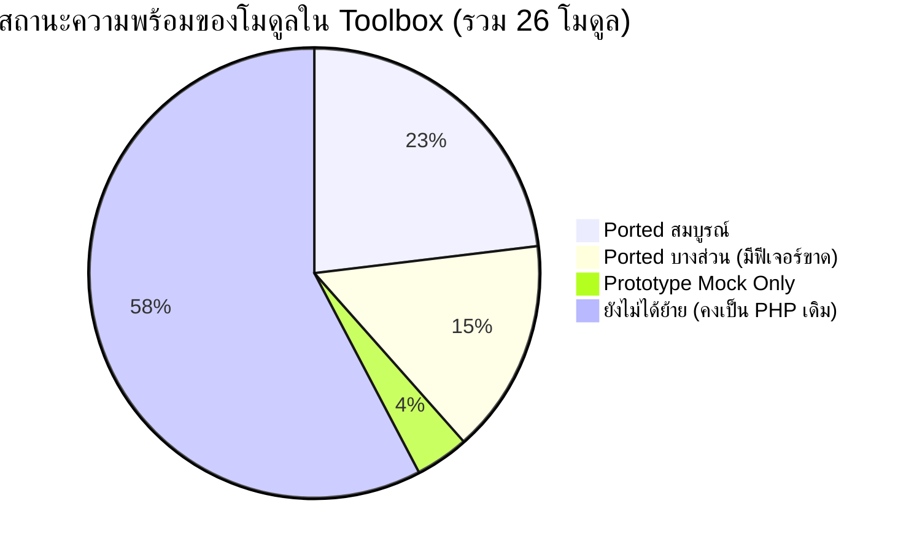
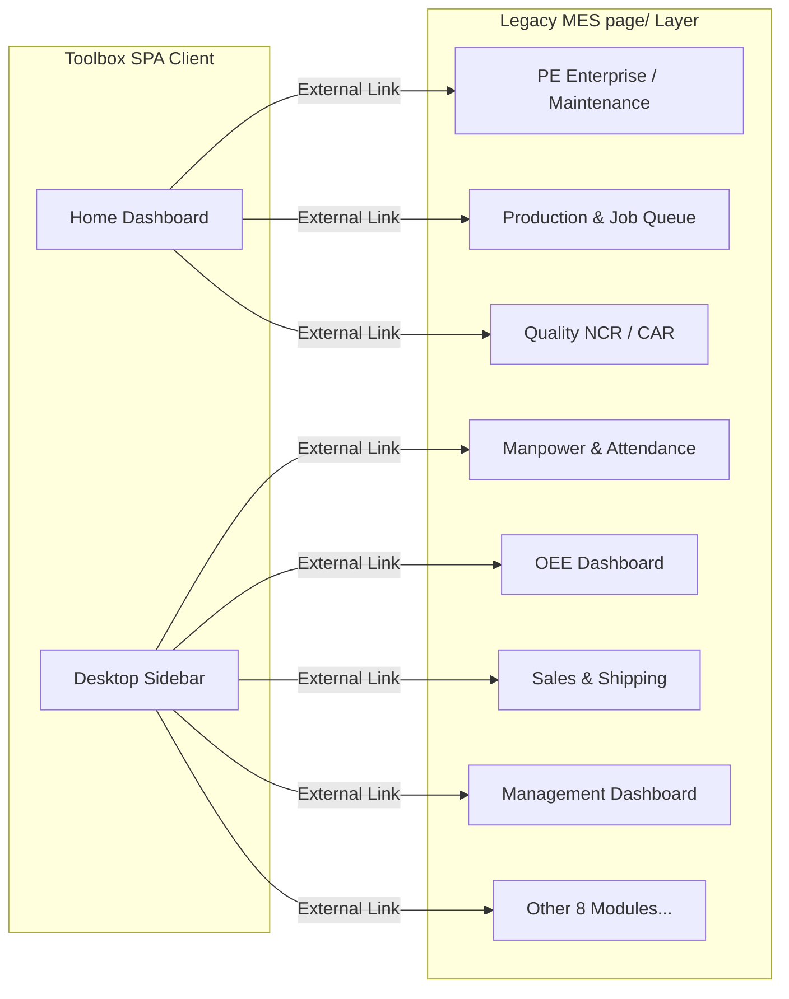

# 📋 รายงานผลการตรวจสอบข้อบกพร่องและฟีเจอร์ที่ขาดหาย (MES Legacy vs Toolbox Audit)
**ระบบเดิม (`page/`) VS ระบบใหม่ (`Toolbox/`)**  
*วันที่ตรวจสอบ: 7 พฤศจิกายน 2026 | บทบาท: MES Quality Assurance & Senior Systems Auditor*

---

## Executive Summary (ภาพรวมสถานะการย้ายระบบ)

จากการตรวจสอบโครงสร้างโค้ด หน้าจอ UI ระบบฐานข้อมูล และ API ทั้งหมดระหว่างระบบเดิม (`MES/page/` จำนวน 26 โมดูล) และระบบใหม่ (`MES/Toolbox/` สถาปัตยกรรม React SPA) สรุปภาพรวมสถานะได้ดังนี้:

| สถานะโมดูล | จำนวน | รายละเอียด |
| :--- | :---: | :--- |
| **✅ Ported 100% (สมบูรณ์)** | **6** | `Admin (User Management)`, `System Settings`, `Profile`, `PaintChem`, `Utility (รวม IoT Ingestion)`, `Document Center (รวม 3D CAD WebGL Viewer)` |
| **⚠️ Partially Ported (ย้ายบางส่วน / มีฟีเจอร์ขาดหาย)** | **4** | `Store Management`, `Forklift`, `Daily Log`, `Transport` |
| **🧪 Prototype / Mock Only (ยังไม่มี Backend จริง)** | **1** | `Inbound Hub` (รันบน Local State และ Mock Data ทั้งหมด) |
| **❌ Unported (ยังไม่ได้พอร์ต / ลิงก์ไปยัง PHP เดิม)** | **15** | `PE (ซ่อมบำรุง)`, `Production`, `QMS`, `AccessoriesInspection`, `Management`, `Manpower`, `OEE_Dashboard`, `Sales`, `LoadingReport`, `DailyPL`, `AutoInvoice`, `CCTV_Downloader`, `AreaAccess`, `ScanBarcode`, `IQS` |

---

## 1. การตรวจสอบโมดูลที่ย้ายแล้ว (Ported Modules) — ข้อบกพร่องและฟีเจอร์ที่ขาดหาย

### 1.1 Store Management (ระบบบริหารคลังสินค้า)
* **Legacy:** `page/storeManagement/` (15 PHP, 14 JS)
* **Toolbox:** `Toolbox/src/modules/Store/` (10 ไฟล์)
* **สถานะ:** ⚠️ **ย้ายแล้ว 35% — ขาดระบบปฏิบัติการหน้างานหลัก 6 ส่วน**

| ฟีเจอร์ย่อย | Legacy (`page/`) | Toolbox (`Toolbox/`) | สถานะ & ข้อบกพร่องที่พบ |
| :--- | :--- | :--- | :--- |
| **Onhand Stock Dashboard** | `inventoryDashboard.php` | `InventoryDashboardTab.jsx` | ⚠️ **ขาดปุ่ม Export to Excel**, ขาดปุ่ม Sync ERP, ใน `ItemDetailsModal.jsx` ขาดแท็บ Tags Breakdown, ขาดแท็บ Pending PO และขาดแท็บประวัติเคลื่อนไหวเฉพาะไอเทม (Item Ledger) |
| **Visual Cycle Count Map** | `cycleCount.php` | `CycleCountTab.jsx` | ✅ ย้ายสมบูรณ์ รองรับ Blind Count, Zone Settings, Zone Health Modal และ Quick Scanner |
| **Pending Approvals** | `inventoryDashboard.php` | `PendingApprovalsTab.jsx` | ✅ ย้ายสมบูรณ์ รองรับการอนุมัติ/ปฏิเสธยอดผลต่างการตรวจนับ |
| **Stock Ledger (บัญชีสต็อก)** | `stockTransaction.php` | `StockLedgerTab.jsx` | ✅ ย้ายสมบูรณ์ มีตัวกรองวันที่ ประเภทรายการ และค้นหา |
| **Material Requisition (เบิกพัสดุ)** | `materialReq.php` | *ไม่มีใน StoreApp* (เป็น External Link) | ❌ **ขาดหายใน SPA**: ตะกร้าช้อปปิ้งเบิกของ (E-commerce Cart), เบิกจากสต็อก vs ขอสั่งซื้อ (K2), ประวัติการสั่งเบิก และ Tracking Modal |
| **RM Receiving & Tagging (รับวัตถุดิบ)** | `rmReceiving.php` | *ไม่มีใน StoreApp* (เป็น External Link) | ❌ **ขาดหายใน SPA**: การรับวัตถุดิบเข้าคลัง, การออกป้าย FIFO Tag, Batch Print ป้ายบาร์โค้ด, Bulk Receive เข้าสต็อก และระบบออฟไลน์ซิงค์ (`StoreOffline.js`) |
| **Scrap & Replacement (เบิกของเสีย/ทดแทน)** | `storeRequest.php` | *ไม่มีใน StoreApp* (เป็น External Link) | ❌ **ขาดหายใน SPA**: เวิร์กโฟลว์เบิกของเสียเคลมทดแทน, การอนุมัติหัวหน้างาน (Bulk Approve/Reject), แดชบอร์ดสรุปยอดเคลม และ Export Excel |
| **Warehouse Operations (จัดการคลัง/สลับตำแหน่ง)** | `warehouse_operations.php` | *ไม่มีใน StoreApp* (เป็น External Link) | ❌ **ขาดหายใน SPA**: โหมดรับเข้า (Receive) vs โหมดจ่ายขาย (Sell/Load), สแกนย้ายพิกัด (Bin Transfer) และ Bulk Action |
| **Trace Tag History (สืบย้อนแท็ก)** | `tagHistory.php` | *ไม่มีใน StoreApp* | ❌ **ขาดหายใน SPA**: การสืบค้นประวัติเส้นทางของ Tag (Genealogy Trace) จากการรับเข้า -> จุดจัดเก็บ -> หน้าไลน์ -> ตู้สินค้า |
| **ISO/IATF Audit Certificate** | `print_cycle_count_audit.php` | *ไม่มีใน StoreApp* | ❌ **ขาดหายใน SPA**: เอกสารใบรับรองผลการตรวจนับสต็อกทางการพร้อมคำนวณ % IRA (Inventory Record Accuracy) และช่องลงนามผู้ตรวจสอบ |

---

### 1.2 Document Center (ศูนย์รวมเอกสารและคู่มือปฏิบัติงาน)
* **Legacy:** `page/documentCenter/` (11 PHP, 1 JS)
* **Toolbox:** `Toolbox/src/modules/DocumentCenter/` (11 ไฟล์)
* **สถานะ:** ✅ **ย้ายแล้ว 100% (สมบูรณ์)**

| ฟีเจอร์ย่อย | Legacy (`page/`) | Toolbox (`Toolbox/`) | สถานะ & ข้อบกพร่องที่พบ |
| :--- | :--- | :--- | :--- |
| **Folder & File Explorer** | `documentCenterUI.php` | `DocumentCenterPage.jsx` | ✅ ย้ายสมบูรณ์ รองรับ Breadcrumb, Tree view, ค้นหา, กรองหมวด |
| **Document Actions** | Modals ต่างๆ | Modals ใน React | ✅ ย้ายสมบูรณ์ (Upload, Rename, Revise version, Move folder, Delete) |
| **PDF & Image Preview** | `viewDocModal.php` | `DocumentPreviewModal.jsx` | ✅ ย้ายสมบูรณ์ แสดงผล PDF และรูปภาพในตัว |
| **Interactive 3D CAD Viewer** | `view3DModal.php` | `DocumentPreviewModal.jsx` (`ThreeDViewer.jsx`) | ✅ **ย้ายสมบูรณ์**: พอร์ต Online 3D Viewer (Three.js WebGL) รองรับการหมุน (Rotate), เลื่อน (Pan), ซูม (Zoom), คำนวณขนาดกว้างxยาวxสูง (Dimensions mm), โหมดเอ็กซเรย์ (X-Ray), ถ่ายภาพหน้าจอ (Screenshot PNG), หมุนอัตโนมัติ (Auto Rotate), และสลับธีมสีพื้นหลัง |

---

### 1.3 Forklift Management (ระบบจัดการและจองรถโฟล์คลิฟท์)
* **Legacy:** `page/forklift/` (10 PHP, 2 JS)
* **Toolbox:** `Toolbox/src/modules/Forklift/` (7 ไฟล์)
* **สถานะ:** ⚠️ **ย้ายแล้ว 50% — ขาดระบบ IoT Telemetry และ Live Tracking Map**

| ฟีเจอร์ย่อย | Legacy (`page/`) | Toolbox (`Toolbox/`) | สถานะ & ข้อบกพร่องที่พบ |
| :--- | :--- | :--- | :--- |
| **Fleet Dashboard & Cards** | `forkliftDashboard.php` | `ForkliftCard.jsx`, `ForkliftPage.jsx` | ✅ ย้ายสมบูรณ์ แสดงสถานะรถ แบตเตอรี่ ผู้ใช้งานปัจจุบัน |
| **Booking & Instant Walk-in** | `forkliftUI.php` | `BookingModal.jsx` | ✅ ย้ายสมบูรณ์ รองรับการจองล่วงหน้าและ Walk-in ทันที |
| **Return & Inspection** | `forkliftUI.php` | `ReturnModal.jsx` | ✅ ย้ายสมบูรณ์ บันทึกระดับแบตเตอรี่และตรวจสภาพ |
| **Fleet Admin CRUD** | `forkliftManage.php` | `ManageFleetModal.jsx` | ✅ ย้ายสมบูรณ์ เพิ่ม/แก้ไข/ลบ/เปลี่ยนสถานะรถ |
| **Live Spatial Map Tracking** | `forkliftMapUI.php` | *ไม่มีใน Toolbox* | ❌ **ขาดหายใน SPA**: แผนที่ติดตามตำแหน่งรถแบบเรียลไทม์ภายในโรงงาน (Indoor Tracking) |
| **Heatmap Density Analysis** | `forkliftTracking.js` | *ไม่มีใน Toolbox* | ❌ **ขาดหายใน SPA**: แผนผังความหนาแน่นของการเดินรถโฟล์คลิฟท์ในแต่ละโซนเพื่อความปลอดภัย |
| **IoT Telemetry Ingestion (ESP32)** | `hardwareTracking.php` | *ไม่มีใน Toolbox API* | ❌ **API ขาดหาย**: Endpoint สำหรับบอร์ด ESP32 บนรถยิงพิกัด WiFi BSSID/RSSI Triangulation และระดับแบตเตอรี่เข้า `dbo.sp_UpdateForkliftLocation_WiFi` |
| **Driver QR Checkout Scan** | `scan.php` | *ไม่มีใน Toolbox* | ❌ **ขาดหายใน SPA**: หน้าเว็บสแกน QR หน้าตัวรถเพื่อปลดล็อกใช้งานทันทีสำหรับพนักงานขับรถ |

---

### 1.4 Utility & Energy Tracking (ระบบติดตามการใช้พลังงาน)
* **Legacy:** `page/management/utilityDashboard.php`
* **Toolbox:** `Toolbox/src/modules/Utility/` (5 ไฟล์) + `public/api/utility/`
* **สถานะ:** ✅ **ย้ายแล้ว 100% (สมบูรณ์)**

| ฟีเจอร์ย่อย | Legacy (`page/`) | Toolbox (`Toolbox/`) | สถานะ & ข้อบกพร่องที่พบ |
| :--- | :--- | :--- | :--- |
| **Electricity & LPG KPI Cards** | `utilityDashboard.php` | `UtilityKpiCards.jsx` | ✅ ย้ายสมบูรณ์ แสดงค่าไฟวันนี้, ค่าก๊าซ LPG, kWh, m³ |
| **Hourly Cost Chart (Stacked/Grouped)** | Chart.js ใน PHP | `HourlyCostChart.jsx` | ✅ ย้ายสมบูรณ์ วิเคราะห์ค่าใช้จ่ายรายชั่วโมงตามเรท TOU |
| **TOU Rates Setting** | Modal ใน PHP | `TouSettingsModal.jsx` | ✅ ย้ายสมบูรณ์ แก้ไขเรท On-Peak, Off-Peak, ค่าแก๊ส LPG |
| **Meters Status Table** | ตารางใน PHP | `MetersTable.jsx` | ✅ ย้ายสมบูรณ์ |
| **Node-RED IoT Ingestion API** | Action: `insert_log` | `utilityApi.php` (Action: `insert_log` & `aggregate_summary`) | ✅ **ย้ายสมบูรณ์**: รองรับการรับข้อมูล Batch มิเตอร์ไฟฟ้าและก๊าซจาก Node-RED พร้อมระบบคำนวณ Summary และความปลอดภัยผ่าน `X-API-KEY: MESKey2026` |

---

### 1.5 Daily Log & Mood Insights (บันทึกประจำวันและสุขภาพใจ)
* **Legacy:** `page/dailyLog/` (9 PHP, 2 JS)
* **Toolbox:** `Toolbox/src/modules/Home/components/` (DailyPulseWidget, CalendarWidget)
* **สถานะ:** ⚠️ **ย้ายแล้ว 40% — มีเฉพาะ Widget ย่อบนหน้าแรก ขาดหน้าระบบเต็ม**

| ฟีเจอร์ย่อย | Legacy (`page/`) | Toolbox (`Toolbox/`) | สถานะ & ข้อบกพร่องที่พบ |
| :--- | :--- | :--- | :--- |
| **Daily Pulse Entry (บันทึกกะ)** | Modal ใน PHP | `DailyPulseWidget.jsx`, `LogModal.jsx` | ✅ ย้ายสมบูรณ์ บันทึกความรู้สึก กิจกรรม ปัญหา |
| **Monthly Calendar Grid** | ปฏิทินใน PHP | `CalendarWidget.jsx` | ✅ ย้ายสมบูรณ์ แสดงจุดสีสถานะการบันทึกแต่ละวัน |
| **Morning Executive Brief** | `morningBriefModal.php` | `MorningBriefModal.jsx` | ✅ ย้ายสมบูรณ์ ดึงข้อมูลสรุปทีมงานยามเช้า |
| **Full Daily Log Ledger (สมุดบันทึกกะเต็ม)** | `dailyLogUI.php` | *ลิงก์ออกภายนอก* (`/page/dailyLog/dailyLogUI.php`) | ❌ **ยังไม่พอร์ตเป็นหน้า SPA เต็ม**: หน้าอ่านบันทึกย้อนหลังทุกไลน์การผลิต การส่งต่อกะ (Shift Handover) และระบบตอบกลับ (Supervisor Reply Thread) |
| **Mood Insight Report (รายงานสุขภาพใจ)** | `moodReport.php` | *ลิงก์ออกภายนอก* (`/page/dailyLog/moodReport.php`) | ❌ **ยังไม่พอร์ตเป็นหน้า SPA**: หน้ารายงาน Mental Health Analytics, Mood Trend กราฟแท่งเปรียบเทียบตามไลน์ และ Mood Distribution Pie Chart |

---

### 1.6 Transport System (ระบบขนส่งและยานพาหนะ)
* **Legacy:** `page/fleetLog/fleetLog.php` (บัญชีเที่ยวรถขนส่งสินค้า) + `transport-system` (รถรับส่งพนักงาน)
* **Toolbox:** `Toolbox/src/modules/Transport/` (26 ไฟล์)
* **สถานะ:** ⚠️ **ความสับสนในการใช้งาน (Semantic Gap)**

| ฟีเจอร์ย่อย | Legacy (`page/`) | Toolbox (`Toolbox/`) | สถานะ & ข้อบกพร่องที่พบ |
| :--- | :--- | :--- | :--- |
| **Employee Shuttle Bus (รถรับ-ส่งพนักงาน)** | `transport-system` | `TransportApp.jsx` | ✅ ย้ายเข้าสู่ Toolbox สมบูรณ์ 100% (จองตั๋ว, สแกนตั๋วคนขับ, จัดการสายรถ) |
| **Freight & Fleet Cost Logistics (บัญชีเที่ยวรถส่งของ)** | `fleetLog.php` | *ไม่มีใน Toolbox SPA* (เป็น External Link) | ❌ **ยังไม่ได้พอร์ต**: การบันทึกบัญชีค่าขนส่งสินค้าของโรงงาน (Truck Cost Breakdown, ค่าน้ำมัน, ค่าทางด่วน, เที่ยววิ่งส่งลูกค้า และการ Export Excel) |

---

### 1.7 Inbound Hub (ศูนย์กลางรับสินค้าขาเข้า SCM-Store)
* **Toolbox:** `Toolbox/src/modules/InboundHub/` (10 ไฟล์)
* **สถานะ:** 🧪 **เป็นเพียงหน้าจอ Prototype / Mock State 100%**
* **ข้อบกพร่องสำคัญ**:
  1. โค้ดทั้งหมดใน `InboundHubContext.jsx` อ่านและเขียนข้อมูลลงบนตัวแปรหน่วยความจำ (`INITIAL_CONTAINERS`, `INITIAL_INVOICES`, `INITIAL_MARKET_RATES`) จากไฟล์ `mockInboundData.js`
  2. เมื่อผู้ใช้งานรีเฟรชหน้าจอ (F5) ข้อมูลตู้คอนเทนเนอร์และ Tag ที่สร้างขึ้นจะหายไปทั้งหมด
  3. ยังไม่มีตารางฐานข้อมูลจริงบน SQL Server และยังไม่มี PHP API รองรับการเชื่อมต่อกับระบบคลังสินค้าจริง

---

## 2. การตรวจสอบโมดูลที่ยังไม่ได้ย้าย (Unported Legacy Modules)

โมดูลเหล่านี้ในปัจจุบันยังคงทำงานอยู่บน PHP/jQuery เดิมในโฟลเดอร์ `page/` และในหน้า Toolbox ทำได้เพียงใส่ลิงก์ภายนอก (`<a>` tag) ชี้กลับไปยัง URL เดิม:

### 2.1 PE (Production Engineering & Maintenance) — **โมดูลที่ใหญ่และสำคัญที่สุด**
* **โครงสร้างเดิม:** 53 PHP files, 17 JS files, 12 Tab components
* **ฟังก์ชันการทำงานหลักที่ยังคงค้างอยู่ในระบบเดิม:**
  1. **Work Order Management (`tab_workorders.php`, `workOrderAPI.php`):** สร้าง/มอบหมาย/รับงานใบแจ้งซ่อม (Corrective, Preventive, Emergency, Predictive), SLA นับถอยหลัง, วิเคราะห์รากสาเหตุ 5-Why & Fishbone, การเบิกอะไหล่ประกอบงานซ่อม และการสร้างเอกสาร PDF ใบสั่งซ่อม
  2. **Machines Master (`tab_machines.php`, `machineAPI.php`):** ฐานข้อมูลเครื่องจักร สเปกทางเทคนิค บันทึกประเภท PLC คอนโทรลเลอร์ การแบ่งระดับความวิกฤต (Criticality Index A/B/C) และเอกสารคู่มือ
  3. **Spare Parts Inventory (`tab_spareparts.php`, `sparePartsAPI.php`):** คลังอะไหล่ซ่อมบำรุง จุดสั่งซื้อ Min/Max reorder points, รับเข้า/ตัดจ่ายอะไหล่เข้างานซ่อม, ตรวจสอบมูลค่าคงคลังอะไหล่
  4. **Breakdown Downtime & MTBF/MTTR (`tab_downtime.php`, `downtimeAPI.php`):** การคำนวณสถิติเครื่องจักรขัดข้อง ความถี่และระยะเวลาเฉลี่ยในการกู้คืนเครื่องจักร พร้อมวิเคราะห์ Pareto chart
  5. **Real-time IIoT & Telemetry (`tab_iiot.php`, `tab_iiot_analytics.php`, `iiotAPI.php`):** แสดงผลข้อมูลเซนเซอร์ IoT กระแสไฟฟ้า การสั่นสะเทือน อุณหภูมิ และตรวจจับสัญญาณความผิดปกติ เชื่อมต่อ Node-RED
  6. **Safety & LOTO (`tab_safety.php`, `tab_print_safety.php`, `safetyAPI.php`):** ระบบความปลอดภัยโรงงาน ใบอนุญาตตัดแยกระบบพลังงาน Lockout/Tagout (LOTO) และรายงาน Near-Miss
  7. **Visual Board 2D/3D Layout (`tab_visual_board.php`, `mapBuilderModule.js`):** ผังโรงงานแสดงสถานะเครื่องจักรสด (เขียว/วิ่ง, เหลือง/เตือน, แดง/หยุด, น้ำเงิน/ซ่อม) แบบลากวาง
  8. **PE Tech Mobile (`peTechMobile.php`):** ระบบเว็บแอปมือถือสำหรับช่างซ่อมบำรุงเดินเครื่องรับงาน ถ่ายรูปแนบ และปิดงานซ่อมหน้างาน
  9. **Stop Causes Call Button (`peRequest.php`):** ปุ่มกดเรียกช่างด่วนหน้าไลน์การผลิต

---

### 2.2 Production (ระบบการผลิตหน้าไลน์)
* **โครงสร้างเดิม:** 10 PHP files, 6 JS files
* **ฟังก์ชันการทำงานหลักที่ยังคงค้างอยู่ในระบบเดิม:**
  1. **Daily Production Entry (`productionUI.php`):** บันทึกยอดผลิตประจำวัน ยอดของเสีย การเลือกกะและไลน์การผลิต
  2. **Live Job Queue / KDS (`jobQueueUI.php`):** คิวงานหน้าไลน์แบบเรียลไทม์ (Kitchen Display System for Factory) แสดงงานปัจจุบัน งานถัดไป และคุมจังหวะ Takt Time
  3. **WIP/FG Thermal Tag Printer (`label_printer.php`):** พิมพ์สติกเกอร์บาร์โค้ดแท็กชิ้นงานระหว่างทำ (WIP) และสินค้าสำเร็จรูป (FG)
  4. **Lot & Transfer Management (`transferManage.php`):** การโอนย้ายชิ้นงานระหว่างแผนก การรวม/แยก Lot

---

### 2.3 QMS (Quality Management System)
* **โครงสร้างเดิม:** 20 PHP files, 1 JS file
* **ฟังก์ชันการทำงานหลักที่ยังคงค้างอยู่ในระบบเดิม:**
  1. **NCR Management (`print_ncr.php`, `ncrFormModal.php`):** ออกใบรายงานความไม่สอดคล้องของชิ้นงาน การกักกันและตัดสินโทษชิ้นงาน
  2. **CAR 8D Problem Solving (`print_car.php`):** เวิร์กโฟลว์การแก้ไขและป้องกันการเกิดซ้ำแบบ 8D รายงานการวิเคราะห์สาเหตุและแผนปฏิบัติการ
  3. **Concession Workflow (`concession_list.php`, `concession_api.php`):** ระบบขอผ่อนผันการใช้วัตถุดิบหรือชิ้นงานพิเศษ
  4. **Customer Claims (`print_claim.php`):** ระบบรับเรื่องร้องเรียนจากลูกค้าและติดตามผลการตรวจสอบ
  5. **QA Inspection Schedule (`qa_calendar.php`, `qa_schedule.php`):** ปฏิทินและตารางนัดหมายการสุ่มตรวจปล่อยสินค้าของทีม QC

---

### 2.4 Manpower & Human Resource
* **โครงสร้างเดิม:** 16 PHP files, 5 JS files
* **ฟังก์ชันการทำงานหลักที่ยังคงค้างอยู่ในระบบเดิม:**
  1. **Daily Manpower Operations (`manpowerUI.php`):** จัดกำลังคนประจำวัน มอบหมายพนักงานลงเครื่องจักร/ไลน์ บันทึกการลา/ขาด/มาสาย
  2. **4D Employee Performance Grading (`employeeGrading.php`):** ระบบประเมินผลงาน 4 มิติ และคำนวณเบี้ยขยัน/เงินพิเศษ
  3. **Grading Trend Analytics (`gradingTrend.php`):** แนวโน้มผลการประเมินย้อนหลังรายบุคคลและรายแผนก
  4. **Competence Skill Matrix (`skillMatrix.php`):** แผนผังระดับทักษะความเชี่ยวชาญของพนักงาน (Level 1-4)
  5. **Company Holidays Calendar (`holidayUI.php`):** ปฏิทินวันหยุดโรงงานประจำปี

---

### 2.5 Executive Management & Planning
* **Management Dashboard (`managementDashboard.php`):** แดชบอร์ดสรุปภาพรวมสำหรับผู้บริหาร รวบรวมข้อมูลการผลิต ยอดขาย ต้นทุน และเศษเสีย
* **Daily Command Center (`page/planning/daily_meeting.php`):** ระบบประชุมสั่งการแผนผลิตตอนเช้า (Morning Meeting) ตรวจสอบความพร้อมของคน เครื่องจักร วัตถุดิบขาดแคลน และยอดส่งมอบ
* **Daily P&L (`page/dailyPL/pl_entry.php`):** ระบบบันทึกและวิเคราะห์งบกำไรขาดทุนรายวัน (Revenue, Direct Material, Labor, Overhead, Freight)
* **OEE Dashboard (`page/OEE_Dashboard/OEE_Shopfloor.php`):** หน้าจอคำนวณและแสดงผล OEE หน้าร้านแบบเรียลไทม์ พร้อมแจกแจงสาเหตุเครื่องจักรหยุด

---

### 2.6 Logistics, Sales & Security
* **Sales Tracking & Shipping (`page/sales/`):** ติดตามสถานะคำสั่งซื้อ (Sales Orders), กำหนดการโหลดตู้สินค้า และการพยากรณ์ความต้องการวัตถุดิบ
* **Loading Report C-TPAT (`page/loadingReport/`):** ระบบตรวจตู้คอนเทนเนอร์ 7 จุดความปลอดภัย C-TPAT พร้อมอัปโหลดภาพถ่าย และพอร์ทัลตรวจสอบสำหรับลูกค้าภายนอก (`customerPortal.php`)
* **Auto Invoice (`page/autoInvoice/`):** ออกเอกสาร Commercial Invoice (CI) และ Packing List (PL) อัตโนมัติจากข้อมูลการโหลดตู้
* **Accessories Inspection (`page/AccessoriesInspection/`):** ระบบสตรีมภาพจากกล้องและ AI ตรวจสอบอุปกรณ์ประกอบ
* **CCTV Downloader (`page/cctv_downloader/`):** ระบบดาวน์โหลดวิดีโอย้อนหลังและเชื่อมโยงกับช่วงเวลาการโหลดตู้สินค้า
* **Area Access Control (`page/areaAccess/`):** ระบบบันทึกการเข้า-ออกพื้นที่หวงห้ามด้วยบัตรพนักงาน

---

## 3. สรุปตารางเปรียบเทียบโมดูลต่อโมดูล (Master Feature Matrix)

| # | โมดูลระบบเดิม (`page/`) | หน้าจอใน Toolbox SPA | สถานะการพอร์ต | ฟีเจอร์ที่ขาดหาย / จุดบกพร่องที่ต้องแก้ไข |
| :-: | :--- | :--- | :-: | :--- |
| **1** | `userManage` | `#/admin/users` | ✅ 100% | มีครบทุกฟังก์ชัน (Users, Matrix, Logs, Approvals) |
| **2** | `systemSettings` | `#/system-settings` | ✅ 100% | มีครบ 5 แท็บ (Item Master, BOM, Locations, Schedules, SAP) |
| **3** | `profile` | `#/profile` | ✅ 100% | มีครบ ข้อมูลส่วนตัว, เปลี่ยนรหัส, Logs, ประเมิน 4D, สวัสดิการ |
| **4** | `paintChem` | `#/paint-chem` | ✅ 100% | สร้าง UI ใหม่สมบูรณ์ พร้อม Sheet, Slot, History, Analytics |
| **5** | `documentCenter` | `#/documents` | ✅ 100% | มีครบทั้ง File Explorer, CRUD, PDF/Image Preview, และ **3D CAD WebGL Viewer** |
| **6** | `storeManagement` | `#/store` | ⚠️ 35% | **ขาด:** Material Req, RM Receiving, Scrap Claim, Warehouse Ops, Tag Trace, Audit Print |
| **7** | `forklift` | `#/forklift` | ⚠️ 50% | **ขาด:** Live Map Tracking, Heatmap, ESP32 IoT API, Driver QR Scan |
| **8** | `management/utility` | `#/utility` | ✅ 100% | มีครบทั้ง Dashboard, TOU Settings, และ API `insert_log` / `aggregate_summary` รับข้อมูล IoT Node-RED |
| **9** | `dailyLog` | `#/` (Home Widgets) | ⚠️ 40% | **ขาด:** หน้าระบบเต็ม Shift Handover, Reply Thread, Mood Insight Report |
| **10** | `fleetLog` / `transport` | `#/transport` | ⚠️ 50% | รถรับส่งพนักงานมีครบ **แต่ขาดบัญชีเที่ยวรถขนส่งสินค้า (Freight Log)** |
| **11** | `InboundHub` (ใหม่) | `#/inbound-hub` | 🧪 Mock | ทำเฉพาะหน้าจำลอง ยังไม่มีตารางฐานข้อมูลและ PHP API จริง |
| **12** | `SystemBlueprint` (ใหม่)| `#/blueprint` | ✅ 100% | ผังพิมพ์เขียวและสถาปัตยกรรมระบบโรงงาน แสดงผลสมบูรณ์ |
| **13** | `PE` (ซ่อมบำรุง) | *ไม่มีใน Toolbox* | ❌ 0% | ใบสั่งซ่อม, ฐานข้อมูลเครื่องจักร, อะไหล่, Downtime, IIoT, LOTO, ผังโรงงาน |
| **14** | `production` | *ไม่มีใน Toolbox* | ❌ 0% | บันทึกยอดผลิต, คิวงาน KDS, พิมพ์ป้ายแท็ก WIP/FG, ตัดยอด |
| **15** | `QMS` | *ไม่มีใน Toolbox* | ❌ 0% | NCR, CAR 8D, Concession, Claims, QA Schedule |
| **16** | `manpower` | *ไม่มีใน Toolbox* | ❌ 0% | จัดคนลงไลน์, ประเมินเกรด 4D, Skill Matrix, วันหยุด |
| **17** | `planning` | *ไม่มีใน Toolbox* | ❌ 0% | ศูนย์สั่งการ Morning Meeting ประจำวัน (คน/เครื่อง/แผน/ของขาด) |
| **18** | `management` | *ไม่มีใน Toolbox* | ❌ 0% | แดชบอร์ดผู้บริหารภาพรวม, ควบคุมแผนหลัก, DLOT |
| **19** | `OEE_Dashboard` | *ไม่มีใน Toolbox* | ❌ 0% | OEE หน้าร้านเรียลไทม์, Speed Loss, Scrap Analysis |
| **20** | `sales` | *ไม่มีใน Toolbox* | ❌ 0% | ติดตามสถานะ PO, กำหนดการโหลดตู้, พยากรณ์วัตถุดิบ |
| **21** | `loadingReport` | *ไม่มีใน Toolbox* | ❌ 0% | ตรวจตู้สินค้า C-TPAT, ภาพถ่ายหลักฐาน, พอร์ทัลลูกค้า |
| **22** | `dailyPL` | *ไม่มีใน Toolbox* | ❌ 0% | บันทึกงบกำไรขาดทุนประจำวัน, ต้นทุนวัตถุดิบ/แรงงาน |
| **23** | `autoInvoice` | *ไม่มีใน Toolbox* | ❌ 0% | สร้าง Commercial Invoice และ Packing List อัตโนมัติ |
| **24** | `AccessoriesInspection` | *ไม่มีใน Toolbox* | ❌ 0% | ระบบตรวจชิ้นงานด้วยภาพถ่าย AI และกล้องสตรีม |
| **25** | `cctv_downloader` | *ไม่มีใน Toolbox* | ❌ 0% | ดาวน์โหลดคลิปกล้องวงจรปิดตามเหตุการณ์โหลดตู้ |
| **26** | `areaAccess` / `scanBarcode` | *ไม่มีใน Toolbox* | ❌ 0% | บันทึกเข้าออกพื้นที่หวงห้าม และเทอร์มินัลสแกนบาร์โค้ด |

---

## 4. ข้อบกพร่องด้านสถาปัตยกรรมและความปลอดภัย (Architectural Gaps)

1. **Authentication & Session Synchronization:**
   * เมื่อผู้ใช้งานล็อกอินเข้า `Toolbox` มีระบบ `mes_auth_channel` ซิงค์ระหว่างแท็บ และมี Inactivity Logout 60 นาที
   * **ปัญหา:** หากผู้ใช้งานคลิกเมนูที่เป็น External Link ออกไปยัง `/MES/page/...` เซสชั่นของหน้า PHP เก่าจะยังคงอ้างอิงกับ `$_SESSION['user']` ของ PHP แบบเดิม หากเกิดการ Logout ใน Toolbox หน้าที่เปิดค้างไว้ในระบบเดิมอาจยังไม่ถูกตัดเซสชั่นทันทีจนกว่าจะรีเฟรช
2. **Offline-First Resilience:**
   * ในระบบเดิม (`page/storeManagement/script/storeOffline.js`) มีระบบบันทึกข้อมูลลง IndexedDB เมื่อเครือข่าย Wi-Fi ในคลังหลุด พร้อมปุ่มกด Manual Sync เมื่อสัญญาณกลับมา
   * ใน `Toolbox` ยังไม่มี Service Worker หรือ IndexedDB Caching สำหรับการสแกนหรือตรวจนับ หากเครือข่ายหลุดขณะเดินตรวจนับในจุดอับสัญญาณ อาจทำให้การยิงบันทึกค้างหรือไม่สำเร็จ
3. **Data Ingestion Parity:**
   * สำหรับฮาร์ดแวร์ภายนอก (Node-RED Power Meters, ESP32 Forklift GPS) ปัจจุบันยังคงยิงตรงไปยัง Endpoint ใน `page/` อยู่ หากปิดระบบเดิมโดยไม่ย้าย Ingestion Endpoints เหล่านี้ จะทำให้ข้อมูล IoT ขาดช่วงทันที

---

## 5. แผนการดำเนินงานและข้อเสนอแนะ (Recommended Migration Action Plan)

เพื่อไม่ให้การทำงานในโรงงานสะดุด แนะนำให้ดำเนินการตามลำดับความสำคัญ (Priority Tiers) ดังนี้:

### 🔴 Phase 1: เติมเต็มฟังก์ชันที่ขาดในโมดูลที่ย้ายแล้ว (Immediate Gaps in Ported Modules)
1. **Store Management:** พอร์ตแท็บ `Material Request` และ `RM Receiving & Tagging` เข้าสู่ `StoreApp.jsx` พร้อมทำปุ่ม Export to Excel ใน Onhand Dashboard
2. [x] **Document Center:** นำไลบรารี Three.js / Online 3D Viewer เข้าสู่ `DocumentPreviewModal.jsx` (`ThreeDViewer.jsx`) เพื่อคืนความสามารถในการดูโมเดล 3D CAD (.step, .stl, .obj) พร้อมคำนวณมิติขนาดและเครื่องมือควบคุมให้วิศวกร (เสร็จสมบูรณ์ 07/11/2026)
3. [x] **Utility API:** เพิ่ม Action `insert_log` และ `aggregate_summary` ใน `Toolbox/public/api/utility/utilityApi.php` เพื่อให้ Node-RED ส่งค่าไฟ/แก๊สได้ต่อเนื่องและคำนวณสรุปอัตโนมัติ (เสร็จสมบูรณ์ 07/11/2026)
4. **Inbound Hub:** สร้างตารางฐานข้อมูลจริงบน SQL Server และเขียน PHP API เพื่อเชื่อมข้อมูลจริงแทน Mock State

### 🟡 Phase 2: ย้ายโมดูลวิศวกรรมและการผลิตหลัก (High-Impact Operational Modules)
1. **PE Enterprise & Maintenance:** ย้ายระบบจัดการใบสั่งซ่อม (Work Orders) และคลังอะไหล่ (Spare Parts) เป็นหน้าจอแรกใน Toolbox ภายใต้ Route `#/pe/*`
2. **Production Execution:** ย้ายระบบ Live Job Queue (KDS) และ Tag Printer เพื่อให้หน้าไลน์ใช้ SPA เต็มรูปแบบ
3. **QMS:** ย้ายระบบ NCR และ CAR เข้าสู่ Toolbox เพื่อการควบคุมคุณภาพแบบไร้รอยต่อ

### 🟢 Phase 3: ย้ายโมดูลการบริหารและโลจิสติกส์ (Management & Administration Modules)
1. **Manpower & Daily Planning:** รวมระบบจัดกำลังคนและ Daily Command Center เข้าด้วยกัน
2. **Sales, Loading Report & Auto Invoice:** รวมสายงานส่งออกและตรวจสอบตู้สินค้า C-TPAT เข้าสู่ระบบใหม่
3. **Executive Dashboard & Daily P&L:** ย้ายแดชบอร์ดงบการเงินและ OEE Dashboard เป็นขั้นตอนสุดท้าย
