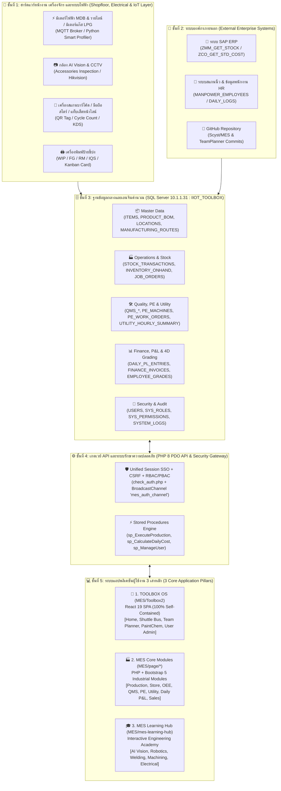
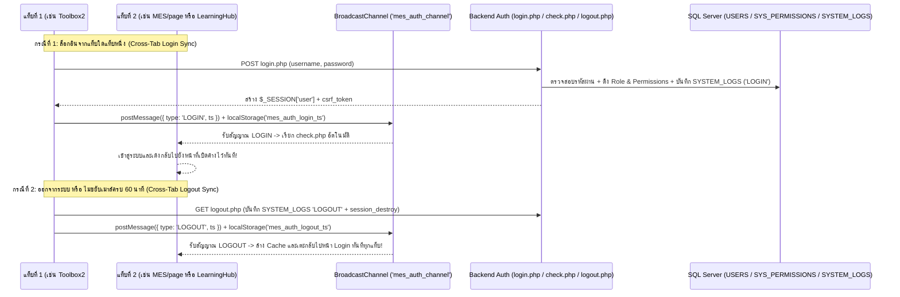
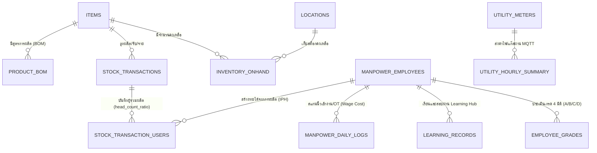

# 📐 พิมพ์เขียวสถาปัตยกรรมระบบโรงงานอัจฉริยะ (MES & IIoT Toolbox Master Blueprint)
**บริษัท เอส เอ็น ซี ฟอร์เมอร์ จำกัด (มหาชน) — SNC Former Public Company Limited (B9)**  
**รหัสเอกสาร:** `SNC-B9-MES-BLUEPRINT-V2`  
**อัปเดตล่าสุด:** 29 ตุลาคม 2026  
**วัตถุประสงค์:** เอกสารพิมพ์เขียวแม่บท (Master Engineering Blueprint) สำหรับผู้บริหาร วิศวกรระบบ และทีมงานรับช่วงต่อ อธิบายโครงสร้างสถาปัตยกรรมซอฟต์แวร์ ฐานข้อมูล จุดเชื่อมต่อระบบไฟฟ้า/เครื่องจักร/IoT/SAP ตลอดจนคู่มือการดูแลรักษาและแก้ไขปัญหาฉุกเฉิน

---

## 1. ภาพรวมสถาปัตยกรรมระบบ 5 ชั้น (5-Layer Enterprise Architecture)

ระบบ MES & IIoT Toolbox ของโรงงานถูกออกแบบให้เชื่อมโยงตั้งแต่ **ระดับฮาร์ดแวร์หน้างาน (มิเตอร์ไฟฟ้า, เครื่องจักร, กล้อง AI, บาร์โค้ด)** ขึ้นสู่ **ฐานข้อมูลกลาง (`IIOT_TOOLBOX`)** ไปจนถึง **แดชบอร์ดผู้บริหารและระบบประเมินผลพนักงาน 4 มิติ** ดังแผนผังพิมพ์เขียวด้านล่าง:



---

## 2. แผนผังเซิร์ฟเวอร์ พาร์ทการติดตั้ง และการตั้งค่า (Server & Deployment Topology)

### 2.1 ข้อมูลเซิร์ฟเวอร์หลัก (Production Environment)
| รายการ | รายละเอียดทางเทคนิค | หมายเหตุสำหรับการดูแลรักษา |
| :--- | :--- | :--- |
| **Web & Application Server** | `https://oem.sncformer.com/iot-toolbox/sandbox-b9/` | Apache + PHP 8.x (เปิดใช้งาน `pdo_sqlsrv`, `gd`, `ftp`, `mbstring`, `curl`) |
| **Database Server (SQL Server)** | IP: `10.1.1.31` \| Database: `IIOT_TOOLBOX` (Production) / `MESToolbox_Dev` (Dev) | ตั้งค่าผ่านไฟล์ `.env` หรือ `config.php` (`IS_DEVELOPMENT = false`) |
| **Git Repository** | `https://github.com/Scyst/MES.git` (Branch หลัก: `main`) | โค้ดทั้งหมดถูกควบคุมเวอร์ชันบน Git ก่อนอัปโหลดขึ้น FTP |

### 2.2 แผนผังการจับคู่โฟลเดอร์ใน Git กับพาร์ทจริงบน FTP Server (1:1 Mapping)
```text
[Git Repository Root]                      [Production FTP Path]                         [Production URL]
├── MES/                                -> /MES/MES/                                  -> .../sandbox-b9/MES/MES/
│   ├── auth/                           -> /MES/MES/auth/                             -> ระบบ Login/Logout กลางของหน้า PHP
│   ├── config/                         -> /MES/MES/config/                           -> ไฟล์ตั้งค่ากลาง (config.php, .env)
│   ├── page/                           -> /MES/MES/page/                             -> โมดูลปฏิบัติการทั้ง 26 โมดูล
│   ├── uploads/                        -> /MES/MES/uploads/                          -> โฟลเดอร์เก็บไฟล์แนบและรูปภาพทั้งหมด (แยกจากโค้ด)
│   │
│   ├── Toolbox2/ (dist/)               -> /Toolbox2/                                 -> .../sandbox-b9/Toolbox2/
│   │   ├── index.html & assets/        -> /Toolbox2/index.html                       -> หน้าบ้าน React SPA (TOOLBOX OS)
│   │   └── public/api/*                -> /Toolbox2/api/*                            -> หลังบ้าน PHP API ของ Toolbox2 (Self-Contained 100%)
│   │
│   ├── mes-learning-hub/ (dist/)       -> /LearningHub/                              -> .../sandbox-b9/LearningHub/
│   └── mes-team-planner/ (dist/)       -> /Toolbox/planner/                          -> .../sandbox-b9/Toolbox/planner/ (คู่ขนานกับ #/planner ใน Toolbox2)
```
> **⚠️ กฎเหล็กด้านความปลอดภัยของไฟล์รูปภาพและไฟล์อัปโหลด:**  
> ห้ามเก็บรูปภาพที่ผู้ใช้อัปโหลดไว้ปะปนในโฟลเดอร์โค้ด (`MES/page/<module>/img/`) เด็ดขาด เพราะเวลา Deploy หรือสำรองข้อมูลอาจเผลอลบทับ ให้เก็บไว้ใน `/MES/MES/uploads/<module_name>/` หรือ `/Toolbox2/uploads/` เสมอ

---

## 3. พิมพ์เขียวระบบความปลอดภัย การยืนยันตัวตน และการซิงค์ข้ามแท็บ (Security, SSO & Cross-Tab Sync)

ระบบทั้งหมด (`MES/page`, `Toolbox2`, `LearningHub`, `TeamPlanner`) ใช้ **PHP Session (`$_SESSION['user']`) ร่วมกันบนโดเมนเดียวกัน** และสื่อสารข้ามแท็บแบบเรียลไทม์ผ่าน `BroadcastChannel('mes_auth_channel')`:



### โครงสร้างสิทธิ์การใช้งาน 2 ระดับ (RBAC + PBAC)
1. **สิทธิ์ตามตำแหน่ง (`dbo.SYS_ROLES` & `dbo.SYS_ROLE_PERMISSIONS`):**
   - `creator` (ผู้พัฒนาระบบสูงสุด — มีสิทธิ์ทุกอย่างอัตโนมัติ)
   - `admin` (ผู้ดูแลระบบโรงงาน)
   - `manager` / `supervisor` / `leader` / `planner` / `operator` / `guest`
2. **สิทธิ์รายบุคคล (`dbo.SYS_USER_PERMISSIONS`):**
   - สามารถมอบสิทธิ์เฉพาะเจาะจง (`perm_code`) ให้พนักงานรายบุคคลเพิ่มเติมจาก Role ปกติได้ผ่านหน้า **User Manager**

---

## 4. สารบัญพิมพ์เขียวครบทั้ง 28 โมดูลของโรงงาน (Complete 28-Module Engineering Catalog)

### 🏭 หมวด A: ระบบบริหารการผลิตและหน้างาน (Production & Shopfloor Operations)
| ลำดับ | ชื่อโมดูล | พาร์ทโค้ดหลัก | ไฟล์ API หลังบ้าน | ตารางฐานข้อมูล / Stored Procedures หลัก | หน้าที่และความเชื่อมโยง |
| :---: | :--- | :--- | :--- | :--- | :--- |
| 1 | **Production & Inventory Entry** (บันทึกผลผลิตและสต็อก) | `MES/page/production/productionUI.php` | `page/production/api/inventoryManage.php`, `transferManage.php` | `STOCK_TRANSACTIONS`, `INVENTORY_ONHAND`, `STOCK_TRANSACTION_USERS`, `sp_ExecuteProduction`, `sp_UpdateOnhandBalance` | บันทึกยอดผลิต FG/WIP/Hold/Scrap, ตัดวัตถุดิบตามสูตร BOM อัตโนมัติ, ผูกชื่อพนักงานผู้ผลิตเพื่อคำนวณค่าผลงาน IPH |
| 2 | **Live Job Queue (KDS)** (คิวงานหน้าไลน์ผลิต) | `MES/page/production/jobQueueUI.php` | `page/production/api/jobManage.php`, `machines.php` | `JOB_ORDERS`, `PRODUCTION_PLANS`, `LINE_SCHEDULES`, `sp_AutoGenerateProductionPlan` | หน้าจอแสดงคิวงานการผลิตแบบเรียลไทม์สำหรับหน้าไลน์ผลิตและวางแผน |
| 3 | **Tag Printer (WIP/FG)** (พิมพ์ป้ายแท็กสินค้า) | `MES/page/production/label_printer.php` | `page/production/api/inventoryManage.php` | `LOT_SERIALS`, `ITEMS`, `MANUFACTURING_ROUTES` | พิมพ์ใบชี้บ่งชิ้นงาน (QR/Barcode Tag) สำหรับแปะพาเลท WIP และ FG |
| 4 | **OEE Dashboard & Shopfloor** (วัดประสิทธิภาพเครื่องจักร) | `MES/page/OEE_Dashboard/` (`OEE_Dashboard.php`, `OEE_Shopfloor.php`) | `page/OEE_Dashboard/api/oeeDashboardApi.php`, `oeeShopfloorApi.php` | `STOP_CAUSES`, `STOCK_TRANSACTIONS`, `sp_CalculateOEE_Dashboard_PieChart`, `sp_CalculateOEE_Hourly_Trend` | คำนวณค่า Availability, Performance, Quality (OEE) รายชั่วโมง/รายวัน และบันทึกสาเหตุเครื่องจักรหยุด |
| 5 | **Scan Barcode** (สแกนบาร์โค้ดรับ-จ่าย) | `MES/page/scanBarcode/scanBarcodeUI.php` | `page/scanBarcode/api/scanManage.php` | `BARCODE_SCAN_DATA`, `QR_SCAN_JOBS`, `ITEMS`, `LOCATIONS` | สแกนบาร์โค้ดตรวจสอบและบันทึกการเคลื่อนย้ายชิ้นงานหน้างาน |
| 6 | **Paint Line Chemical Control** (บันทึกเคมีสี & SPC) | `MES/Toolbox2/src/modules/PaintChem/` (`#/paint-chem`) | `Toolbox2/public/api/paintChem/*.php` (10 ไฟล์) | `PAINT_CHEM_SHEET_HEADER`, `PAINT_CHEM_LOG` | **(พอร์ตเข้า Toolbox2 แล้ว 100%)** บันทึกค่าพารามิเตอร์บ่อเคมีสี 10 สถานี 6 ช่วงเวลา พร้อมกราฟ SPC วิเคราะห์แนวโน้มและพิมพ์ใบตรวจเช็ค PDF |
| 7 | **Daily Production Meeting** (ประชุมแผนผลิตประจำวัน) | `MES/page/planning/daily_meeting.php` | `page/planning/api/dailyMeetingApi.php` | `DAILY_MEETINGS` | บันทึกสรุปวาระการประชุมวางแผนการผลิตประจำวันและติดตามประเด็นค้างคา |

---

### 📦 หมวด B: ระบบคลังสินค้า โลจิสติกส์ และยานพาหนะ (Warehouse, Store & Logistics)
| ลำดับ | ชื่อโมดูล | พาร์ทโค้ดหลัก | ไฟล์ API หลังบ้าน | ตารางฐานข้อมูล / Stored Procedures หลัก | หน้าที่และความเชื่อมโยง |
| :---: | :--- | :--- | :--- | :--- | :--- |
| 8 | **Store & Warehouse Management** (ระบบบริหารคลังสินค้าครบวงจร) | `MES/page/storeManagement/` (`storeDashboard.php`, `inventoryDashboard.php`, `warehouse_operations.php`, `rmReceiving.php`, `cycleCount.php`, `materialReq.php`) | `page/storeManagement/api/api_store.php` *(Single Source of Truth 72 Actions)* | `INVENTORY_ONHAND`, `STOCK_TRANSACTIONS`, `STOCK_TRANSFER_ORDERS`, `LOCATIONS`, `INVENTORY_CYCLE_COUNTS` | ศูนย์กลางคลังสินค้า: รับวัตถุดิบ (RM Receiving), เบิกจ่ายพัสดุ (Material Req), ตรวจนับสต็อกบนมือถือแบบ Visual Map (Blind Cycle Count), และอนุมัติยอดปรับปรุงสต็อก |
| 9 | **Forklift Booking & Tracking** (จองและติดตามรถโฟร์คลิฟต์) | `MES/page/forklift/` (`forkliftUI.php`, `forkliftMapUI.php`, `forkliftDashboard.php`) | `page/forklift/api/forkliftManage.php`, `hardwareTracking.php`, `webTracking.php` | `FORKLIFTS`, `FORKLIFT_BOOKINGS` | ระบบจองคิวใช้งานรถโฟร์คลิฟต์ แสดงพิกัดสถานะรถบนแผนผังโรงงาน และติดตามการใช้งาน |
| 10 | **Fleet Log (Transport & Logistics)** (บัญชีเที่ยวรถขนส่งสินค้า) | `MES/page/fleetLog/fleetLog.php` | `page/fleetLog/api/apiFleetLog.php` | `FLEET_LOGS` (ตารางบันทึกเที่ยวรถขนส่ง) | บันทึกเที่ยวรถขนส่งวัตถุดิบและสินค้าสำเร็จรูป คำนวณค่าขนส่งและติดตามสถานะรถบรรทุก |
| 11 | **Employee Shuttle Bus** (ระบบจองรถรับ-ส่งพนักงาน) | `MES/Toolbox2/src/modules/Transport/` (`#/transport/*`) | `Toolbox2/public/api/transport/*.php` | ตารางระบบจองรถรับส่ง (`Transport_*`), `MANPOWER_EMPLOYEES` | **(พอร์ตเข้า Toolbox2 แล้ว 100%)** ระบบจองที่นั่งรถรับ-ส่งพนักงาน สแกนตั๋ว QR Code สำหรับคนขับ และระบบคำนวณค่าใช้จ่ายรถรับส่ง |
| 12 | **Loading Report (C-TPAT)** (รายงานตรวจสอบตู้สินค้า & พอร์ทัลลูกค้า) | `MES/page/loadingReport/` (`loading_report.php`, `customerPortal.php`) | `page/loadingReport/api/manage_loading.php`, `customerViewAPI.php` | `LOADING_REPORTS`, `LOADING_PHOTOS`, `LOADING_INSPECTION_RESULTS`, `SALES_ORDERS` | ถ่ายรูปและตรวจเช็คสภาพตู้คอนเทนเนอร์ตามมาตรฐานความปลอดภัย C-TPAT พร้อมหน้า Public Tracking ให้ลูกค้าตรวจสอบสถานะได้ |
| 13 | **Sales & Shipping Tracking** (ติดตาม PO และแผนโหลดสินค้า) | `MES/page/sales/` (`salesDashboard.php`, `shipping_loading.php`) | `page/sales/api/manage_sales_orders.php`, `manage_shipping.php`, `forecast_rm.php` | `SALES_ORDERS`, `ITEMS`, `PRODUCT_BOM` | ติดตามสถานะคำสั่งซื้อของลูกค้า (PO), วางแผนการจัดส่งสินค้า (Shipping Loading), และพยากรณ์ความต้องการใช้วัตถุดิบ (RM Forecast) |

---

### 🛡️ หมวด C: ระบบควบคุมคุณภาพ วิศวกรรมเครื่องจักร และพลังงาน/ไฟฟ้า (Quality, PE, Electrical & AI Vision)
| ลำดับ | ชื่อโมดูล | พาร์ทโค้ดหลัก | ไฟล์ API หลังบ้าน | ตารางฐานข้อมูล / ฮาร์ดแวร์ที่เชื่อมต่อ | หน้าที่และความเชื่อมโยง |
| :---: | :--- | :--- | :--- | :--- | :--- |
| 14 | **iQMS (Quality Management System)** (ระบบบริหารคุณภาพ NCR/CAR/Claim) | `MES/page/QMS/qmsDashboard.php` | `page/QMS/api/qms_action.php`, `concession_api.php`, `qa_schedule_api.php` | `QMS_CASES`, `QMS_NCR`, `QMS_CAR`, `QMS_CLAIM`, `QMS_FILE` | จัดการใบแจ้งของเสีย (NCR), การวิเคราะห์รากเหง้าและป้องกันการเกิดซ้ำ (CAR 8D), ใบเคลมลูกค้า, และใบขออนุมัติใช้ชิ้นงานพิเศษ (Concession) |
| 15 | **IQS (Inspection Quality Standard)** (มาตรฐานการตรวจสอบคุณภาพ) | `MES/page/IQS/` (`iqsUI.php`, `print_iqs.php`) | `page/IQS/api/iqs_api.php` | ตารางมาตรฐาน IQS & Spec ชิ้นงาน | จัดเก็บและพิมพ์ใบมาตรฐานการตรวจสอบคุณภาพประจำสถานีงาน |
| 16 | **Accessories Inspection (AI Vision)** (ระบบตรวจเช็คอุปกรณ์เสริมด้วยกล้อง) | `MES/page/AccessoriesInspection/accessoriesInspectionUI.php` | `page/AccessoriesInspection/api/inspectionAPI.php`, `upload_image.php`, `cam_proxy.php` | เชื่อมต่อกล้อง IP Camera + เก็บรูปใน `/MES/MES/uploads/accessories_inspection/` | ตรวจสอบความครบถ้วนของชุดอุปกรณ์เสริมก่อนแพ็คลงกล่อง พร้อมบันทึกภาพหลักฐานอัตโนมัติ |
| 17 | **PE Enterprise (Machinery & Maintenance)** (ศูนย์กลางเครื่องจักรและซ่อมบำรุง) | `MES/page/PE/` (`peDashboard.php`, `peRequest.php`, `peTechMobile.php`) | `page/PE/api/*.php` (20 ไฟล์) | `PE_MACHINES`, `PE_WORK_ORDERS`, `PE_DOWNTIME_LOG`, `PE_MACHINE_HISTORY`, `MT_ITEMS`, `MT_INVENTORY_ONHAND` | ระบบแจ้งซ่อมเครื่องจักร (Work Order), แอปมือถือสำหรับช่างเทคนิค PE, ประวัติการซ่อมบำรุงเครื่องจักร, และระบบคลังอะไหล่ซ่อมบำรุง (MT Spare Parts) |
| 18 | **Utility & Electrical Energy Monitoring** (ระบบติดตามพลังงานไฟฟ้าและแก๊ส LPG) | `MES/page/management/utilityDashboard.php` + `MES/page/components/py/Electric/` | `page/management/api/api_utility.php`, `get_utility_dashboard.php` | `UTILITY_METERS`, `UTILITY_HOURLY_SUMMARY` + **MQTT Broker (มิเตอร์ไฟฟ้า MDB/รายไลน์ & LPG)** | ดึงข้อมูลการใช้ไฟฟ้า (kWh / kW) และก๊าซ LPG จากมิเตอร์จริงผ่านโปรโตคอล MQTT คำนวณค่าไฟ/ค่าแก๊สรายชั่วโมง และส่งเข้าสรุปต้นทุนรายวัน (`Daily P&L` & `Morning Brief`) |
| 19 | **CCTV Downloader** (ระบบดึงภาพกล้องวงจรปิด) | `MES/page/cctv_downloader/cctv_downloaderUI.php` | `page/cctv_downloader/api/*.php` (7 ไฟล์) | เชื่อมต่อ NVR / กล้อง CCTV โรงงาน | ค้นหาและดาวน์โหลดคลิปวิดีโอจากกล้องวงจรปิดตามช่วงเวลาที่เกิดเหตุการณ์หรืออุบัติเหตุ |
| 20 | **Area Access Control** (บันทึกการเข้า-ออกพื้นที่หวงห้าม) | `MES/page/areaAccess/areaAccess.php` | `page/areaAccess/api/apiAreaAccess.php` | ตารางบันทึกการเข้า-ออกพื้นที่ควบคุม | บันทึกและตรวจสอบประวัติการเข้า-ออกพื้นที่สำคัญตามคำสั่งผู้บริหาร |

---

### 👥 หมวด D: ระบบทรัพยากรบุคคล การประเมินเกรด 4 มิติ และสมุดบันทึกกะ (HR, 4D Grading & Academy)
| ลำดับ | ชื่อโมดูล | พาร์ทโค้ดหลัก | ไฟล์ API หลังบ้าน | ตารางฐานข้อมูลหลัก | หน้าที่และความเชื่อมโยง |
| :---: | :--- | :--- | :--- | :--- | :--- |
| 21 | **Manpower & 4D Employee Grading** (จัดการกำลังคนและประเมินเกรด 4 มิติ) | `MES/page/manpower/` (`manpowerUI.php`, `employeeGrading.php`, `gradingTrend.php`, `skillMatrix.php`, `holidayUI.php`) | `page/manpower/api/*.php` (9 ไฟล์) + `Toolbox2/public/api/manpower/api_my_performance.php` | `MANPOWER_EMPLOYEES`, `MANPOWER_DAILY_LOGS`, `MANPOWER_SHIFTS`, `EMPLOYEE_GRADES`, `EMP_SKILLS`, `MANPOWER_CALENDAR` | จัดการอัตรากำลังคนรายวัน คำนวณค่าแรง (Normal + OT) และประเมินเกรดพนักงาน 4 มิติ (**1. ค่าผลงาน IPH**, **2. 5ส**, **3. การมาทำงาน**, **4. การเรียนรู้ Learning Hub**) |
| 22 | **Daily Log & Mood Insight** (สมุดบันทึกกะและวิเคราะห์ความรู้สึกพนักงาน) | `MES/Toolbox2/src/modules/Home/` (`#/`) & `MES/page/dailyLog/moodReport.php` | `Toolbox2/public/api/dailyLog/dailyLogManage.php` & `page/dailyLog/api/moodReportAPI.php` | `OPERATOR_DAILY_LOGS` | พนักงานบันทึกความรู้สึก (Mood 1-5) และปัญหาหน้างาน 3 ช่วงเวลา (เริ่มงาน/พักเที่ยง/เลิกงาน) พร้อมระบบให้หัวหน้างานตอบกลับและสรุป Morning Brief |
| 23 | **MES Learning Hub (Engineering Academy)** (ศูนย์ฝึกอบรมและสอบวัดผลวิศวกรรม) | `MES/mes-learning-hub/` (`/LearningHub`) | เชื่อมต่อ API บันทึกผลสอบลง DB | `LEARNING_RECORDS`, `EMP_SKILLS` | หลักสูตร Interactive Masterclass (AI Machine Vision, Industrial Robotics, Welding, Machining, Electrical, Heat Exchanger) พร้อม Interactive Simulators และระบบสอบวัดผลที่ส่งคะแนนเข้าเกรดมิติที่ 4 อัตโนมัติ |

---

### 📈 หมวด E: ระบบผู้บริหาร การเงิน งบกำไรขาดทุน และแผนงานทีม (Executive, Finance & Team Planner)
| ลำดับ | ชื่อโมดูล | พาร์ทโค้ดหลัก | ไฟล์ API หลังบ้าน | ตารางฐานข้อมูล / Stored Procedures หลัก | หน้าที่และความเชื่อมโยง |
| :---: | :--- | :--- | :--- | :--- | :--- |
| 24 | **Executive & Management Dashboard** (แดชบอร์ดผู้บริหารระดับสูง) | `MES/page/management/` (`executiveDashboard.php`, `managementDashboard.php`) | `page/management/api/get_executive_dashboard.php`, `get_line_details.php` | `sp_GetDashboardStats`, `sp_CalculateProductionCostSummary`, `sp_CalculateActualCostSummary` | แสดงภาพรวมรายได้ ต้นทุนการผลิตจริงเทียบมาตรฐาน (Std vs Actual Cost) กำไรขั้นต้น และสถานะการผลิตของทุกไลน์แบบเรียลไทม์ |
| 25 | **Daily P&L (Profit & Loss)** (งบกำไรขาดทุนรายวัน) | `MES/page/dailyPL/` (`pl_entry.php`, `pl_setting.php`) | `page/dailyPL/api/manage_pl_entry.php`, `manage_pl_master.php` | `PL_STRUCTURE`, `DAILY_PL_ENTRIES`, `MONTHLY_PL_TARGETS`, `sp_GetPLEntryData_WithTargets`, `sp_GetPLReport_Range` | บันทึกและคำนวณงบกำไรขาดทุนรายวันของโรงงาน เทียบกับเป้าหมายรายเดือน (Monthly Target) |
| 26 | **Auto Invoice & Finance** (ระบบออกอินวอยซ์และใบแพ็คกิ้งลิสต์) | `MES/page/autoInvoice/` (`finance_dashboard.php`, `print_ci.php`, `print_pl.php`) | `page/autoInvoice/api/api_invoice.php` | `FINANCE_INVOICES`, `FINANCE_INVOICE_DETAILS`, `sp_Finance_ImportInvoice` | นำเข้าข้อมูลและพิมพ์เอกสาร Commercial Invoice (CI) และ Packing List (PL) มาตรฐานส่งออก |
| 27 | **Document Center** (ศูนย์กลางคู่มือและเอกสารโรงงาน) | `MES/page/documentCenter/documentCenterUI.php` | `page/documentCenter/api/documentCenterAPI.php`, `view_document.php` | `DOCUMENTS`, `DOCUMENT_ACCESS_LOGS` | จัดเก็บคู่มือการทำงาน (WI/SOP) เอกสารคุณภาพ และบันทึกประวัติการเข้าอ่านเอกสารของพนักงาน |
| 28 | **MES Team Planner** (กระดานแผนงาน ไทม์ไลน์ Gantt และปฏิทินทีม) | `MES/Toolbox2/src/modules/TeamPlanner/` (`#/planner/*`) & `MES/mes-team-planner/` | `Toolbox2/public/api/planner/*.php` (22 ไฟล์) | `TeamPlanner_Tasks`, `TeamPlanner_Projects`, `TeamPlanner_Spaces`, `TeamPlanner_Events`, `TeamPlanner_Activities` | **(พอร์ตเข้า Toolbox2 แล้ว 100%)** ระบบบริหารจัดการโปรเจ็ค ตาราง Gantt Timeline ไร้ช่องว่าง (Zero-Gap Protocol), แชททีม, คลังไฟล์, เชื่อมต่อ GitHub Commits และมี `agent_api.php` ให้ AI Agent บันทึกงานอัตโนมัติ |

---

### ⚙️ หมวด F: ระบบตั้งค่าข้อมูลหลักและผู้ดูแลระบบ (Core Master Data & System Admin)
- **`systemSettings` (`MES/page/systemSettings/systemSettings.php`):** จัดการข้อมูลหลัก 5 ส่วน ได้แก่ **Item Master (`ITEMS`)**, **BOM Manager (`PRODUCT_BOM`)**, **Locations (`LOCATIONS`)**, **Line Schedules (`LINE_SCHEDULES`)**, และ **SAP Valuation (`sap_staging_inventory` / `sap_staging_costs`)**
- **`userManage` & `profile` (`MES/Toolbox2/src/modules/Admin/` & `AccountSettingsModal.jsx`):** จัดการบัญชีผู้ใช้งาน สิทธิ์ RBAC/PBAC ซิงค์รายชื่อพนักงานจาก HR Manpower (`sp_SyncExistingUsersFromManpower`) และตรวจสอบประวัติ `SYSTEM_LOGS`

---

## 5. พิมพ์เขียวสายธารข้อมูลหลัก (Core Data Pipeline & ER Blueprint)

ความเชื่อมโยงที่สำคัญที่สุดของโรงงานคือ **"การไหลของข้อมูลตั้งแต่การผลิต -> สต็อก -> ต้นทุนพลังงาน/แรงงาน -> งบกำไรขาดทุน -> การตัดเกรดพนักงาน"**:



### สมการธุรกิจหลักที่ฝังอยู่ในระบบ:
1. **รายได้ต่อหัวพนักงาน (Income Per Head — `IPH`):**
   $$\text{IPH} = \sum \left( \text{Head Count Ratio} \times \text{Qty FG} \times (\text{Std Cost DL} + \text{Std Cost OH}) \right)$$
2. **อัตราส่วนความคุ้มค่าแรงงาน (`Income Ratio` บนมุมขวาบนของ Header):**
   $$\text{Ratio} = \frac{\text{Income Per Head (IPH)}}{\text{Total Wage (ค่าแรงปกติ + OT สะสมของเดือน)}}$$
   - ถ้า $\text{Ratio} \ge 2.0 \rightarrow \text{Grade A}$ | $\ge 1.5 \rightarrow \text{Grade B}$ | $\ge 1.0 \rightarrow \text{Grade C}$ | $< 1.0 \rightarrow \text{Grade D}$ (หรือตามเกณฑ์ `EMPLOYEE_GRADING_CRITERIA` ของแต่ละไลน์)

---

## 6. จุดเชื่อมต่อฮาร์ดแวร์ ระบบไฟฟ้า และระบบภายนอก (Hardware, Electrical & External Integration)

1. **ระบบมิเตอร์ไฟฟ้าและแก๊ส LPG (`MES/page/components/py/Electric/`):**
   - สคริปต์ Python (`mqtt_full_logger.py`, `live_power_monitor.py`, `check_power_mqtt.py`) รับข้อมูลจาก MQTT Broker ของโรงงาน
   - บันทึกลงตาราง `dbo.UTILITY_METERS` และสรุปรายชั่วโมงลง `dbo.UTILITY_HOURLY_SUMMARY` (แยกประเภท `ELECTRIC` และ `LPG` โดยไม่นับรวมมิเตอร์หลัก `MDB` ซ้ำซ้อนเวลาคิดต้นทุนรายไลน์)
2. **ระบบเชื่อมต่อ SAP ERP (`MES/page/systemSettings/api/cron_sync_sap_staging.php` & `sync_sap_items.php`):**
   - ดึงข้อมูลสต็อก (`ZMM_GET_STOCK`) และต้นทุนมาตรฐาน (`ZCO_GET_STD_COST`) จาก SAP พักไว้ในตาราง `sap_staging_inventory` และ `sap_staging_costs`
   - เปรียบเทียบส่วนต่าง (Variance) กับตาราง `ITEMS` ในหน้า SAP Valuation
3. **ระบบกล้องตรวจชิ้นงานและ CCTV (`AccessoriesInspection` & `cctv_downloader`):**
   - ใช้ `cam_proxy.php` และ `cam_config.php` เป็นตัวกลางเชื่อมต่อกล้อง IP Camera ภายในวงแลนโรงงาน เพื่อป้องกันการเปิดเผยรหัสผ่านกล้องออกสู่ฝั่ง Browser

---

## 7. คู่มือการดูแลรักษาและการกู้ภัยฉุกเฉิน (Maintenance & Emergency Handover Runbook)

หากผู้ดูแลระบบหลักไม่อยู่ วิศวกรที่มารับช่วงต่อสามารถตรวจสอบและแก้ไขปัญหาตามขั้นตอนมาตรฐานนี้ได้ทันที:

### กรณีที่ 1: ระบบหน้าเว็บขึ้นว่าเชื่อมต่อฐานข้อมูลไม่ได้ (`Database Connection Error`)
1. ตรวจสอบว่าเซิร์ฟเวอร์ SQL Server ที่ IP `10.1.1.31` (ฐานข้อมูล `IIOT_TOOLBOX`) ยังออนไลน์อยู่หรือไม่
2. ตรวจสอบไฟล์ตั้งค่าการเชื่อมต่อที่:
   - ระบบหลัก (`MES/page`): `MES/config/config.php` และ `MES/config/.env`
   - ระบบใหม่ (`Toolbox2`): `MES/Toolbox2/public/config.php` และ `MES/Toolbox2/public/.env`

### กรณีที่ 2: พนักงานล็อกอินเข้าได้แต่กดปุ่มไม่ได้ หรือขึ้น `Permission Denied (403)`
1. เข้าไปที่หน้า **User Manager** (`/iot-toolbox/sandbox-b9/MES/MES/page/userManage/userManageUI.php` หรือ `#/admin/users`)
2. ตรวจสอบ `Role` ของพนักงาน และดูที่แท็บ **Roles & Permissions Matrix** ว่า Role นั้นได้รับสิทธิ์ (`perm_code`) หรือยัง
3. หากต้องการให้สิทธิ์เฉพาะคน ให้กดปุ่ม **Edit User** แล้วติ๊กเพิ่มสิทธิ์รายบุคคล (`SYS_USER_PERMISSIONS`)

### กรณีที่ 3: ต้องการแก้ไขโค้ดและอัปเดตระบบ `Toolbox2` ขึ้นเซิร์ฟเวอร์จริง
1. เปิด Terminal ที่โฟลเดอร์ `MES/Toolbox2`
2. รันคำสั่ง `npm run build` (Vite จะคอมไพล์ React และก๊อปปี้ไฟล์ PHP API ใน `public/api/*` ทั้งหมดไปไว้ในโฟลเดอร์ `dist/` อัตโนมัติ)
3. อัปโหลดไฟล์ใน `MES/Toolbox2/dist/` ขึ้นไปยัง `/Toolbox2/` บน FTP Server (หรือรัน `node upload.cjs`)

---

## 8. แนวทางการต่อยอดสู่ระบบ Visual Interactive Blueprint (สำหรับพัฒนาต่อในอนาคต)

เพื่อรองรับความต้องการของผู้บริหารในการแสดงผลพิมพ์เขียวแบบ **Visual Interactive Map (แผนผังกราฟิกแบบโต้ตอบได้ เหมือนผังวงจรไฟฟ้า/ผังโรงงาน 3D)** เอกสารฉบับนี้ได้ถูกสร้างคู่กับไฟล์ฐานข้อมูลกราฟโครงสร้างระบบที่:
- 📄 **[`MES/docs/blueprint/blueprint_graph.json`](./blueprint_graph.json)**

**วิธีให้ AI Agent หรือทีมงานพัฒนาต่อเป็นหน้าเว็บ Visual Blueprint:**
- ไฟล์ `blueprint_graph.json` เก็บข้อมูลทุกส่วนของโรงงานในรูปแบบ `nodes` (ฮาร์ดแวร์/ไฟฟ้า, ตาราง DB, API, โมดูลทั้ง 28 ตัว) และ `edges` (เส้นทางการไหลของข้อมูล)
- สามารถนำเข้าไลบรารี **React Flow (`@xyflow/react`)** หรือ **Mermaid / D3.js** เพื่อสร้างโมดูล `#/blueprint` ใน `MES/Toolbox2` ที่ผู้บริหารสามารถคลิกที่ **"มิเตอร์ไฟฟ้า"** หรือ **"การผลิต"** แล้วเห็นเส้นวิ่งเชื่อมไปยังตารางฐานข้อมูลและหน้าจอรายงานที่เกี่ยวข้องได้แบบเรียลไทม์ทันที
