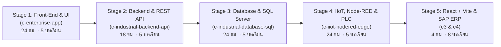

# 🗺️ พิมพ์เขียวเส้นทางการเรียนรู้วิศวกรซอฟต์แวร์โรงงานครบวงจร (Enterprise Full-Stack & MES Learning Roadmap)

เอกสารฉบับนี้คือ **Master Curriculum Blueprint** สำหรับต่อยอดผู้เรียนจากหลักสูตรอบรมมาตรฐาน 4 วัน (`c-enterprise-app` ซึ่งเน้น Front-End Dashboard & API Consumer) สู่การเป็น **Full-Stack MES & Industrial IoT Engineer** ที่สามารถพัฒนาได้ตั้งแต่การดึงสัญญาณ PLC หน้างาน, การออกแบบฐานข้อมูล SQL Server, การเขียน REST API หลังบ้าน ไปจนถึงสถาปัตยกรรม React + Vite ระดับองค์กร

---

## 🏗️ โครงสร้างเส้นทางการเรียนรู้ 5 ระดับ (5-Stage Mastery Path)

---

### Stage 1: Front-End Dashboard, Industrial UX/UI & API Consumer (`c-enterprise-app`)
- **สถานะ:** ✅ พัฒนาเสร็จสมบูรณ์ 100% (พร้อมสไลด์ 102 หน้า, 8 Interactive Simulators, 4 Workshops, ข้อสอบ Standard 20 ข้อ & Expert 40 ข้อ)
- **บทบาทเป้าหมาย:** *Level 3 Industrial Front-End Specialist*
- **ทักษะหลัก:**
  1. พีระมิดสถาปัตยกรรมอุตสาหกรรม ISA-95 (Level 0–4) & IT/OT Convergence
  2. การออกแบบหน้าจอโรงงานตามมาตรฐานสี IEC 60204-1 และปุ่มกดขนาด $\ge 44 \times 44\text{ px}$
  3. โครงสร้าง Semantic HTML5, CSS Box Model & Flexbox Responsive Layout
  4. ตรรกะ JavaScript ES6+, DOM Manipulation, Event Listeners (`click`, `input`)
  5. การดึงข้อมูลด้วย `fetch()` (`async/await`), Polling vs Webhook Alert, และการตรวจรับงาน UAT / BVA

---

### Stage 2: Industrial Backend & RESTful API Engineering (`c-industrial-backend-api`)
- **สถานะ:** ✅ โครงสร้างหลักสูตร 5 บทเรียน + โค้ดต้นแบบ Production + ห้องทดลอง SQL Injection Defense Lab + Checkpoint & Quiz พร้อมใช้งานบนระบบ (พร้อมขยายผลเนื้อหาเชิงลึกใน Phase 2)
- **บทบาทเป้าหมาย:** *Level 3–4 Backend API Engineer*
- **โครงสร้าง 5 บทเรียน (`backend-m1` ถึง `backend-m5`):**
  - **Module 1 (`backend-m1-architecture`):** สถาปัตยกรรมฝั่ง Server & การออกแบบ RESTful API Contract มาตรฐานโรงงาน (`{"success": bool, "data": mixed, "message": string}`)
  - **Module 2 (`backend-m2-endpoints`):** การสร้าง API Endpoint จริง (`GET`, `POST`, `PUT`, `DELETE`) & การทำ Server-Side Input Validation (ตรวจค่า 0, ค่าติดลบ, ขอบเขตตัวเลขการผลิต)
  - **Module 3 (`backend-m3-pdo-security`):** การเชื่อมต่อฐานข้อมูลด้วย PDO Prepared Statements & การป้องกันช่องโหว่ SQL Injection / XSS 100% (พร้อม Interactive SQL Injection Simulator)
  - **Module 4 (`backend-m4-auth-csrf`):** ระบบยืนยันตัวตน Session Hygiene (`HttpOnly`, `SameSite=Strict`, `Secure`), RBAC แยกสิทธิ์พนักงาน/หัวหน้างาน และการบังคับตรวจ CSRF Token
  - **Module 5 (`backend-m5-audit-resilience`):** การจัดการข้อผิดพลาดด้วย `try...catch`, การทำ `$pdo->rollBack()` เมื่อธุรกรรมล้มเหลว และการบันทึก Audit Trail (`oldData` / `newData`) ตามมาตรฐาน ISO 9001

---

### Stage 3: Industrial Database Engineering & SQL Server for MES (`c-industrial-database-sql`)
- **สถานะ:** ✅ โครงสร้างหลักสูตร 5 บทเรียน + โค้ด DDL/T-SQL ต้นแบบ + ห้องทดลอง SQL OEE Calculator Simulator + Checkpoint & Quiz พร้อมใช้งานบนระบบ
- **บทบาทเป้าหมาย:** *Level 4 Industrial Data & DB Architect*
- **โครงสร้าง 5 บทเรียน (`db-m1` ถึง `db-m5`):**
  - **Module 1 (`db-m1-schema-design`):** การออกแบบตารางฐานข้อมูลโรงงาน (ER Diagram: `WORK_ORDERS`, `BOM`, `INVENTORY_ITEMS`, `PRODUCTION_LOGS` และการผูก Foreign Key เพื่อทำ End-to-End Traceability)
  - **Module 2 (`db-m2-sql-queries`):** คำสั่ง SQL สำหรับสายการผลิต (`SELECT`, `INNER/LEFT JOIN`, `GROUP BY`, `CASE WHEN`) และการทำ Server-Side Pagination (`OFFSET ... FETCH NEXT`)
  - **Module 3 (`db-m3-oee-stored-procs`):** การสร้าง Stored Procedures คำนวณดัชนี OEE ($Availability \times Performance \times Quality$) แบบ Real-Time และการป้องกัน Divide by Zero ด้วย `NULLIF` (พร้อม Interactive OEE Engine Simulator)
  - **Module 4 (`db-m4-acid-transactions`):** การควบคุม ACID Transactions และการล็อกแถวข้อมูลด้วย `WITH (UPDLOCK, ROWLOCK)` เพื่อป้องกัน Race Condition เมื่อพนักงานยิงบาร์โค้ดตัดสต็อกพร้อมกัน
  - **Module 5 (`db-m5-indexing-performance`):** กลยุทธ์การสร้าง Non-Clustered Covering Index (`INCLUDE`) และการเขียน SARGable Queries สำหรับตารางที่มีข้อมูลระดับล้านแถว

---

### Stage 4: Industrial IoT (IIoT), Node-RED & PLC Edge Integration (`c-iiot-nodered-edge`)
- **สถานะ:** ✅ โครงสร้างหลักสูตร 5 บทเรียน + โค้ด Node-RED Function ต้นแบบ + ห้องทดลอง PLC Register Scaler & Store-and-Forward Simulator + Checkpoint & Quiz พร้อมใช้งานบนระบบ
- **บทบาทเป้าหมาย:** *Level 4 IIoT & Edge Integration Engineer*
- **โครงสร้าง 5 บทเรียน (`iiot-m1` ถึง `iiot-m5`):**
  - **Module 1 (`iiot-m1-protocols`):** สถาปัตยกรรม Edge Gateway & การเปรียบเทียบโปรโตคอลอุตสาหกรรม (Modbus TCP Port 502, OPC-UA Port 4840, และ MQTT Port 1883/8883)
  - **Module 2 (`iiot-m2-plc-registers`):** การอ่านตาราง PLC Memory Map (Coils `0xxxx`, Discrete Inputs `1xxxx`, Input Registers `3xxxx`, Holding Registers `4xxxx`) และการคำนวณ Linear Scaling แปลงค่า Raw ADC `0–4095` เป็นหน่วยวิศวกรรมจริง
  - **Module 3 (`iiot-m3-nodered-flows`):** การพัฒนา Data Pipeline ด้วย Node-RED (การตั้งเวลา Polling, การใช้ RBE/Deadband กรองสัญญาณซ้ำ และการใช้ Context Memory `flow.get/set` ป้องกันการสแปมแจ้งเตือน)
  - **Module 4 (`iiot-m4-mqtt-uns-sql`):** การจัดระเบียบโครงสร้างหัวข้อข้อมูลตามมาตรฐาน ISA-95 Unified Namespace (`Enterprise/Site/Area/Line/Machine`), ระดับ QoS 0/1/2, Last Will (LWT) และการยิงข้อมูลเข้า SQL Server
  - **Module 5 (`iiot-m5-edge-resilience`):** การออกแบบระบบ Store-and-Forward (Offline Edge Buffering เก็บข้อมูลลงคิวท้องถิ่นเมื่อเน็ตโรงงานหลุด) และหลักการแยกวงแลนเครื่องจักร (OT Firewall / Read-Only Gateway)

---

### Stage 5: Enterprise SPA Architecture & ERP Integration (`c3` & `c4`)
- **สถานะ:** ✅ เชื่อมโยงเข้าสู่แทร็ก Full-Stack เรียบร้อยแล้ว
- **หลักสูตรย่อย:**
  - **Stage 5A (`c3`):** *React + Vite Production Architecture Guide (MES SPA)*
  - **Stage 5B (`c4`):** *Enterprise System & Security Architecture (MES x SAP)*

---

## 🚀 แผนงานขยายผลในเฟสต่อไป (Phase 2 Deep-Dive Expansion Plan)
เมื่อต้องการขยายความละเอียดของแต่ละคอร์สใน Stage 2, 3, และ 4 เพิ่มเติมในอนาคต สามารถดำเนินการต่อได้ทันทีตามลำดับ:
1. **เพิ่มคลังข้อสอบ Dual-Mode (Standard 20 ข้อ / Expert 40 ข้อ)** ให้กับ `c-industrial-backend-api`, `c-industrial-database-sql`, และ `c-iiot-nodered-edge` ใน `assessmentBank.js`
2. **เพิ่มโจทย์ Workshop ปฏิบัติการ (Hands-on Lab Guides)** สำหรับแต่ละ Stage (เช่น สร้างไฟล์ `api_workorder.php`, เขียน Stored Procedure จริง, และนำเข้าไฟล์ `flows.json` เข้า Node-RED)
